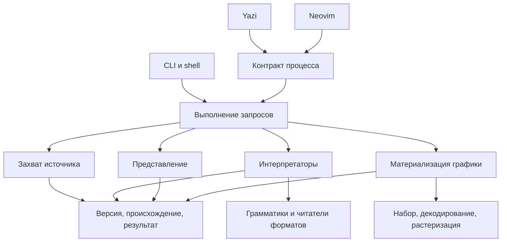
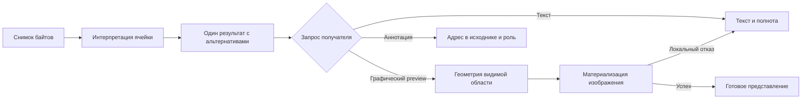

> Статус: исследовательский материал / предложение. Текущая реализация и команды
> описаны в [README.md](README.md), рабочие правила — в [AGENTS.md](AGENTS.md).
> Упоминание компонента здесь не означает, что он реализован.

# ii · Независимый архитектурный проект

**Статус — предложение к утверждению.** Исследование выполнено 23 ноября 2026 года по рабочему
дереву `ii` на базе `4ec75ad`, включая незакоммиченные изменения, примерам из `ii_old` и публичным
контрактам хостов. Ниже отдельно указаны наблюдения, выведенные требования и проектные решения.
Свойства, для которых нужны измерения, снабжены условиями проверки.

## 1. Какую задачу решает система

Есть три разных основания построить продукт. Для _конвертера файлов_ основным результатом был бы
файл заданного формата. Для _редактора_ существенными операциями были бы изменение, сохранение и
разрешение конфликтов. Для _инструмента инспекции_ результатом служит доступное получателю описание
или наглядное представление чужих данных. Третья гипотеза объясняет все наблюдаемые входы, включая
поток без имени, несохранённый буфер и двоичный контейнер. Производство самостоятельных выходных
файлов и владение правками исходника для этих сценариев не обязательны. Терминал, редактор и
файловый менеджер определяют способы доставки результата. [CLI и stdin](src/main.rs) ·
[Интеграция редактора](plugins/ii.nvim/lua/ii/init.lua) ·
[Интеграция файлового менеджера](plugins/ii.yazi/main.lua)

**Рабочая постановка задачи.** По предоставленной версии входных данных извлечь сведения, доступные
поддерживаемым интерпретаторам, и выдать запрошенное представление в пределах возможностей
получателя и бюджета ресурсов. Результат должен сохранять смысл доступной информации и показывать
границы интерпретации. Например, название контейнера и перечень его элементов — разные по полноте
ответы.

### Классификация на примерах

| Наблюдение                                                                                                                   | Что представляет вход                                                                                                      | Что делает система                                                                         | Что это устанавливает                                                                                                                                                                                                     |
| ---------------------------------------------------------------------------------------------------------------------------- | -------------------------------------------------------------------------------------------------------------------------- | ------------------------------------------------------------------------------------------ | ------------------------------------------------------------------------------------------------------------------------------------------------------------------------------------------------------------------------- |
| Выражение приходит в отдельном TeX-файле, между разделителями Markdown или в MIME-выводе notebook.                           | Разные кодировки и контейнеры могут обозначать одно математическое выражение.                                              | Распознаёт границы, набирает формулу, при ошибке может показать литерал.                   | Выражение имеет собственную семантику внутри обработчика математики. Вычисление значения и глобальная идентичность формулы не требуются. [TeX](src/fmt/tex.rs) · [Markdown](src/fmt/md.rs) · [Notebook](src/fmt/ipynb.rs) |
| Для ZIP и TAR читаются записи, для сжатого контейнера доступна сводка заголовка.                                             | Архив — реальный тип входного объекта. Членство записи в контейнере имеет смысл в пределах этого объекта.                  | Инспектирует перечень или метаданные.                                                      | Обязательны точность и явная полнота ответа. Извлечение файлов, универсальная файловая система и рекурсивная распаковка из наблюдений не следуют. [Обработчик](src/fmt/archive.rs) · [Тесты](tests/fmt.rs)                |
| CSV/TSV дают строки и поля. Спецификация графика содержит данные и указания, как их изобразить.                              | «Датасет» объединяет примеры в разговоре. Пустое поле таблицы, числовая точка и спецификация графика имеют разные правила. | Показывает табличные значения или строит график поддерживаемого вида.                      | Общая аналитическая модель, схема БД и вывод типов для каждого значения не обоснованы. Категории таблицы и графика полезны там, где различаются операции. [Таблицы](src/fmt/csv.rs) · [Графики](src/fmt/chart.rs)         |
| В Markdown значим порядок фрагментов и границы inline-разметки. В notebook значимы ячейки и альтернативы MIME одного вывода. | «Смешанный текст» описывает случай композиции. У notebook есть структура, даже когда текста нет.                           | Сохраняет порядок соседних элементов и выбирает доступное представление одного результата. | Последовательность и выбор альтернатив — разные отношения. Сведение обоих к списку картинок теряет сведения. [Markdown](src/fmt/md.rs) · [Notebook](src/fmt/ipynb.rs)                                                     |
| Описание диаграммы и готовый SVG могут визуально выглядеть одинаково.                                                        | В первом случае надо интерпретировать граф, во втором уже задано изображение.                                              | Выполняет разные преобразования до получения визуального результата.                       | Общий выходной тип не устанавливает общую грамматику, стоимость или безопасный способ обработки. [DOT](src/fmt/dot.rs) · [Mermaid](src/fmt/mermaid.rs) · [SVG](src/fmt/svg.rs)                                            |

**Минимальная семантическая модель.** У источника есть содержимое и, при необходимости, версия. У
интерпретации есть область применимости, результат и степень полноты. У результата может быть
происхождение — диапазон байтов, ячейка и номер вывода, запись контейнера или источник целиком.
Представление отвечает на конкретный запрос получателя. Файл, путь, строка экрана, идентификатор
изображения и дескриптор процесса принадлежат разным областям. Для формулы из stdin нужны лишь
содержимое, интерпретация и результат. Для аннотации в редакторе дополнительно нужны версия и адрес
в исходнике. Это проверка модели на двух предельных случаях.

## 2. Требования и системные инварианты

| Требование                                                                        | Основание                                                                                                              | Проверяемый результат                                                                                                                                                               |
| --------------------------------------------------------------------------------- | ---------------------------------------------------------------------------------------------------------------------- | ----------------------------------------------------------------------------------------------------------------------------------------------------------------------------------- |
| F1. Принять именованный файл, байтовый поток или версию буфера.                   | Файл и stdin — входы CLI. Редактор присылает текущее содержимое.                                                       | Одинаковые байты с одинаковой подсказкой формата дают одинаковую интерпретацию. Несохранённые изменения доступны. Путь с пробелом или ведущим дефисом остаётся одним аргументом.    |
| F2. Определить применимость интерпретации и глубину поддержки.                    | У расширения, MIME и сигнатуры разные области достоверности. Не каждый JSON — график, не каждый бинарный файл — текст. | Можно отличить распознанный тип, частично поддержанный вариант, ошибку синтаксиса и неизвестный тип. Явное указание типа снимает неоднозначность, ошибки разбора остаются видимыми. |
| F3. Сохранять содержимое и отношения, существенные для конкретного входа.         | Проза вокруг математики, порядок записей, поля таблиц, варианты MIME.                                                  | Проверяются исходные значения, порядок, пустые элементы и fallback. Графика одного блока может отказать без потери соседнего текста.                                                |
| F4. Выдавать результат, пригодный для запрошенной операции.                       | Для конвейера shell нужен поток, для preview — ограниченная область, для редактора — привязка к источнику.             | Читаемый вывод в pipe, ограниченный preview, аннотация в нужной редакции. Отсутствие графической поддержки даёт осмысленное текстовое представление.                                |
| F5. Различать изменение содержимого, изменение запроса и прекращение потребления. | Один источник может быть открыт в двух окнах. Размер, палитра и активность окна меняются независимо от текста.         | Изменение ширины обновляет раскладку. Устаревший ответ либо ответ после закрытия окна не воздействует на хост.                                                                      |

**Инварианты продукта**

1. **Происхождение.** Диапазон относится к определённой версии и системе координат. Позиция в
   исходнике измеряется по исходным байтам. Для созданного элемента допустима привязка к родителю.
   Для сетки и изображения есть собственные единицы. Преобразование между ними явное.
2. **Честная полнота.** Пустой успешный результат, сокращение по лимиту, недоступное представление и
   ошибка различимы. Ограничение числа строк или точек должно быть видно потребителю.
3. **Согласованность.** Один опубликованный ответ относится к одной версии источника и одному
   запросу. Детерминизм семантики проверяется при одинаковых байтах и настройках интерпретации. Для
   воспроизводимости пикселей дополнительно фиксируются метрики, шрифты и версия движка.
4. **Ограниченная работа.** Для входных байтов, распаковки, пикселей, выхода и числа одновременно
   выполняемых операций существуют отдельные пределы. Состояние ожидания медленного получателя также
   учитывается в бюджете.
5. **Владение эффектами.** Содержимое считается данными. Управлять терминалом, файлами вывода и
   состоянием окна вправе только доверенный адаптер. Просмотр notebook не выполняет код ячеек.

### Атрибуты качества

Для разового запуска важны время до первого полезного результата и отсутствие обязательной
настройки. Для повторного запроса к той же версии — повторное использование независимо от
конкретного окна. Для тяжёлого ввода — ограниченное потребление памяти, отмена и независимость
управляющего потока хоста. Для сопровождения — возможность проверить новый интерпретатор без
терминала и добавить получателя без второй реализации грамматики. Сквозная «нулевая аллокация»
несодержательна для декодирования изображения неизвестного размера. Проверяемая цель имеет границу,
например повторная выдача уже измеренного диапазона при достаточной ёмкости буфера. Ориентир в 5 000
строк оценивается по собственным производственным исходникам с отдельным учётом Rust и Lua. Удаление
проверок или перенос кода в плагин не сокращает стоимость системы.

### Внешние контракты и ограничения

| Граница                          | Что предоставляет внешняя сторона                                                                                             | Что обязан обеспечить ii                                                                                                                                                                                                                                                                                              |
| -------------------------------- | ----------------------------------------------------------------------------------------------------------------------------- | --------------------------------------------------------------------------------------------------------------------------------------------------------------------------------------------------------------------------------------------------------------------------------------------------------------------- |
| ОС, файловая система, shell      | Путь в представлении ОС, дескриптор или поток, частичные чтения, EOF и закрытие pipe. Файл может меняться во время чтения.    | Ограничить чтение. Зафиксировать полученную последовательность байтов. Для меняющегося файла сообщить о замеченном изменении или повторить чтение в пределах бюджета. Идентичность результата не выводить из одного пути или времени модификации.                                                                     |
| Neovim                           | Буфер, отдельные окна, редакции, исходные строки, extmarks и механизм оконных декораций.                                      | Адресовать байтовые колонки конкретного буфера. Различать общую семантику буфера и зависимые от окна декорации. Проверять актуальность непосредственно перед публикацией. [API Neovim](https://github.com/neovim/neovim/blob/master/runtime/doc/api.txt)                                                              |
| Yazi                             | Запрос preview, область, смещение и API виджетов. Для показа изображения документирован вызов с URL и прямоугольником.        | Установить единицу прокрутки, привязать результат к текущему запросу, управлять временем жизни предоставленного изображения. Возможность одновременно разместить несколько независимых изображений требует проверки для каждой поддерживаемой конфигурации. [API Yazi](https://yazi-rs.github.io/docs/plugins/utils/) |
| Терминал, SSH, мультиплексор     | Размер ячейки и графические возможности зависят от конкретного сеанса. Kitty различает передачу изображения и его размещение. | Передавать только поддерживаемые операции. Выбирать текст при неизвестной возможности. Учитывать владение изображениями и удалять размещения в том сеансе, где они созданы. [Графический протокол Kitty](https://sw.kovidgoyal.net/kitty/graphics-protocol/)                                                          |
| Библиотеки интерпретации, шрифты | Разные грамматики и ошибки, работа переменной стоимости, различия метрик текста.                                              | Определить поддерживаемое подмножество на примерах, проверить лимиты до дорогих операций, включать влияющие версии в воспроизводимые результаты.                                                                                                                                                                      |

### Данные, состояние и жизненный цикл

| Данные                               | Владелец и срок жизни                                             | Правило согласованности и хранения                                                                                                                                                                             |
| ------------------------------------ | ----------------------------------------------------------------- | -------------------------------------------------------------------------------------------------------------------------------------------------------------------------------------------------------------- |
| Оригинал                             | Пользователь, файловая система или хост редактора                 | Система получает право чтения. Источником истины остаётся владелец. Несохранённый текст не записывается на диск по умолчанию.                                                                                  |
| Захваченные байты и их интерпретация | Конкретная операция или сессия до освобождения последним запросом | Можно заимствовать срезы из неизменяемого снимка. Для декодированного JSON-текста нужно собственное хранилище и ссылка на исходное поле. Смещения декодированной строки не являются смещениями исходного JSON. |
| Параметры представления              | Отдельный потребитель                                             | Два окна могут запрашивать разные результаты от одной редакции. Смена темы не меняет извлечённые значения.                                                                                                     |
| Производные данные                   | Исполнитель, ограниченный объёмом памяти или жизнью запроса       | Их можно пересоздать. Постоянное хранилище и обмен между процессами — возможные оптимизации с отдельной ценой, а не требование предметной области.                                                             |
| Эффекты хоста                        | Адаптер, который их опубликовал                                   | При замене, отмене и закрытии освобождаются принадлежащие ему ресурсы. Временный файл изображения живёт как минимум до завершения чтения принимающей стороной.                                                 |

### Обработка, отказы, безопасность и расширение до выбора архитектуры

Логический порядок определяется доступностью информации. Сначала нужны байты и признаки формата.
Затем можно проверить применимость и получить факты или локальную ошибку. Размер в ячейках нужен при
выборе представления. Чтение заголовка контейнера иногда завершает запрос сразу. Растеризация бывает
необходима лишь для части ответа. Этот порядок допускает немедленную обработку в одном проходе,
отложенное вычисление и отдельные процессы. Потребности в параллельности и долгоживущем состоянии
различаются между запросами.

| Событие или граница доверия                                                    | Требуемое поведение                                                                                                                                                                         | Наблюдаемый сигнал                                                    |
| ------------------------------------------------------------------------------ | ------------------------------------------------------------------------------------------------------------------------------------------------------------------------------------------- | --------------------------------------------------------------------- |
| Повреждённый фрагмент, неподдерживаемый вариант                                | Вернуть доступные данные и локальную причину, сохранить соседние результаты.                                                                                                                | Категория, происхождение и признак частичного ответа.                 |
| Чрезмерный размер, глубина вложенности, число точек или площадь декодирования  | Проверить бюджет до выделения памяти. Сократить результат с пометкой или отказать в конкретной операции.                                                                                    | Вид и достигнутое значение лимита.                                    |
| Отмена, разрыв канала, изменение редакции                                      | Прекратить доступную для отмены работу, отбросить результат устаревшего поколения, освободить ресурсы.                                                                                      | Отдельно считать отмены и ошибки.                                     |
| Недоверенный текст, имя записи, SVG, вложение notebook                         | Экранировать управляющие символы на текстовом выходе. Ограничить внешние ссылки и декодирование. Просмотр содержимого не даёт права на запись по именам из содержимого или сетевые запросы. | Класс причины без содержимого и полного пути в журналах по умолчанию. |
| Отказ движка, нехватка места для временного файла, несовпадение версий клиента | Сохранить исходник, предложить доступную текстовую форму. Восстановить сессию из последней версии хоста.                                                                                    | Время этапа, код причины и число повторов. Повтор ограничен.          |

Расширяемость имеет две независимые оси. Новый входной язык меняет распознавание и извлечение
сведений. Новый хост меняет доставку и координаты. Третья ось возникает, если нужен иной способ
показать уже известное значение, например таблицу как текст или изображение. Оснований для
публичного ABI сторонних модулей, многопользовательского сервиса, распределённых вычислений и
обязательной долговечной базы в наблюдениях нет. Неизвестны частота повторов между приложениями,
доля дорогих форматов и распределение размеров. Эти неизвестные существенно влияют на выбор
исполнения.

## 3. Независимые варианты

**A. Потоковые преобразователи.** Получатель заказывает преобразование входа в конечный формат.
Специализированная функция читает данные и пишет порции результата. Процесс заканчивается вместе с
запросом. Для обычного текста и последовательного перечня это самый короткий путь. Глобальные
конструкции грамматики, редакторские координаты и повторное представление при другой ширине требуют
буферизации или нового прохода.

**B. Запросы к неизменяемой версии источника.** Интерпретатор выдаёт компактные факты и
происхождение. Каждый получатель выбирает операцию над ними. Дорогой результат материализуется по
запросу. Разовый запуск владеет версией до EOF, редактор может удерживать её между запросами. Цена
подхода — явные правила времени жизни и риск построить слишком общую модель.

**C. Конвейер изолированных декодеров.** Координатор передаёт ограниченный вход в отдельный процесс
нужного формата. Декодеры выдают стандартные артефакты и диагностические сообщения. Такой подход
позволяет прервать один зависший декодер и выбирать разные языки реализации. Потребуются
распределение бюджетов, упаковка исполнителей и версионирование их контрактов.

**D. Нативное расширение каждого хоста.** Хост вызывает библиотеку интерпретации непосредственно и
сам отвечает за планирование, отображение и кеширование. Исчезает межпроцессная передача снимка. Для
нескольких хостов появляются нативные сборки и привязки к разным API. Отказ библиотеки разделяет
судьбу процесса редактора или файлового менеджера.

| Критерий           | A · поток                                         | B · запрос к версии                                            | C · изолированные декодеры                          | D · встраивание                                            |
| ------------------ | ------------------------------------------------- | -------------------------------------------------------------- | --------------------------------------------------- | ---------------------------------------------------------- |
| Сложность          | Минимальна для одного результата                  | Индекс, границы версий и два режима жизни                      | Протокол, процессы, очереди, надзор                 | Простой вызов, сложнее интеграции                          |
| Сопровождение      | Общие правила могут разойтись между выходами      | Одно место проверки происхождения                              | Независимые декодеры, дороже изменение контракта    | Согласование версий библиотеки и обвязок                   |
| Производительность | Ранний первый байт, повтор при новом запросе      | Повторная проекция использует те же факты, индекс стоит памяти | Параллелизм тяжёлых задач, передача артефактов      | Минимальные копии на границе, конкуренция за ресурсы хоста |
| Расширяемость      | Легко добавить одиночную пару вход/выход          | Входы и получатели расширяются раздельно                       | Сильная изоляция независимых поставщиков            | Глубокая специализация под конкретный хост                 |
| Надёжность         | Простое завершение, восстановление новым запуском | Нужна проверка поколения до публикации                         | Отказ локализован процессом декодера                | Сбой может затронуть пользовательское приложение           |
| Эксплуатация       | Один запуск на запрос                             | Один бинарник, редактор владеет своим дочерним процессом       | Несколько исполнителей, политики ресурсов и очистки | Нативная поставка под хост, ОС и архитектуру               |
| Опыт разработчика  | Легко отладить на stdin                           | Можно воспроизвести версию и запрос без UI                     | Нужны стенд и трасса нескольких процессов           | Удобны инструменты хоста, различаются тестовые среды       |

**Что определяет выбор.** При единственной задаче «файл → текст» оправдан A. Если запускаются
сторонние декодеры или требуется принудительная изоляция каждой операции, преимущество у C. Для
одного контролируемого хоста с доказанно недопустимой стоимостью копирования следует проверить D. В
наблюдаемой постановке одновременно нужны разовый вызов, повторное представление одной версии и
точная привязка к редактируемому источнику. B покрывает эти три условия одной семантикой. Поэтому
ниже выбран **B**, с прямым поточным выводом для одноразовых простых запросов. Это выбор модели
вычислений. Выигрыш в задержке предстоит измерить.

## 4. Целевая архитектура из пустого репозитория

Главная граница проходит между **сведениями об источнике** и **результатом конкретного запроса**.
Таблица записей архива существует независимо от ширины окна. Видимые столбцы, число строк и
обозначение усечения принадлежат запросу. Для математического выражения можно сохранить тип и
диапазон, отложив дорогой набор. Глобальный граф объектов и универсальная графическая сцена для этих
двух случаев избыточны.

### Компоненты и контракты

Названия ниже обозначают зоны изменения. Их можно реализовать плоскими модулями одного Rust-пакета.

| Компонент              | Вход → выход                                                                                                                    | Владеет                                                                   | Причина границы                                                                                                                              |
| ---------------------- | ------------------------------------------------------------------------------------------------------------------------------- | ------------------------------------------------------------------------- | -------------------------------------------------------------------------------------------------------------------------------------------- |
| Источник               | Дескриптор, поток или байты хоста → неизменяемые байты, идентификатор версии                                                    | Снимком и индексом начал строк по необходимости                           | Только эта граница знает, как получены байты. Можно воспроизвести интерпретацию из памяти.                                                   |
| Интерпретаторы         | Байты, подсказка типа и лимиты → типизированное значение, происхождение и полнота                                               | Локальными правилами формата                                              | Для прозы, записи каталога, таблицы или рецепта изображения допустимы разные структуры хранения. Общими остаются несколько операций запроса. |
| Запрос и представление | Версия, вид результата, область интереса, возможности получателя → строки с ролями, исходные аннотации либо описание размещений | Выбором сведений, единицами, переносами и резервированием места           | Изменение темы или окна не требует повторной интерпретации файла. Для терминального экспорта достаточно последовательной выдачи.             |
| Материализация графики | Рецепт видимого объекта, ограничения размера и визуальные настройки → изображение или локальный отказ                           | Временной памятью библиотеки и результатом вычисления                     | Здесь учитываются пиксели и стоимость компилятора. Текстовый запрос не обязан проходить через этот компонент.                                |
| Выполнение             | Запросы клиента → завершённый результат, отмена или ошибка                                                                      | Версиями в работе, очередью и бюджетом производных данных                 | Управляет временем жизни и вводом-выводом. Семантические преобразования остаются тестируемыми в памяти.                                      |
| Адаптер получателя     | Готовый результат → операции конкретного хоста                                                                                  | Терминальными размещениями, декорациями окна или временным файлом preview | Только получатель знает, что окно всё ещё существует и что результат можно публиковать.                                                      |

**Граф зависимостей.** Стрелка означает право использовать контракт. У интерпретатора нет
зависимости от очереди, ОС, клиента или протокола вывода.

**Движение данных на одном примере.** Один вывод ячейки notebook может содержать текстовую и
графическую альтернативы. Текстовый экспорт выбирает доступный текст, графический запрос —
поддерживаемое изображение. При ошибке декодирования сохраняются текст и причина. Повторное чтение
файла и вывод двух копий одного результата для этого не нужны.

### Публичная поверхность и модель исполнения

| Операция            | Обязательные параметры                                                                                              | Успех и границы                                                                                                                                                                                |
| ------------------- | ------------------------------------------------------------------------------------------------------------------- | ---------------------------------------------------------------------------------------------------------------------------------------------------------------------------------------------- |
| Принять версию      | Идентификатор источника в пределах сессии, редакция, байты, необязательная подсказка типа                           | Возвращает ссылку на неизменяемый снимок. При превышении лимита предыдущая принятая редакция остаётся доступной.                                                                               |
| Запросить результат | Ссылка на снимок, идентификатор запроса, вид результата. Для окна также поколение, геометрия, область и возможности | Выдаёт данные, полноту, происхождение и локальные ошибки. Текстовый экспорт может выдавать порции с итоговым статусом. Оконный кадр публикуется после проверки его целостности и актуальности. |
| Отменить запрос     | Идентификатор запроса в этой сессии                                                                                 | Повторная отмена безопасна. Уже доставленный результат хост может снять. Поздний ответ не восстанавливает снятое размещение.                                                                   |
| Отпустить версию    | Ссылка на снимок                                                                                                    | Новые запросы к освобождённой версии отклоняются. Занятые байты освобождаются после последнего активного чтения. Обрыв соединения закрывает все ссылки клиента.                                |

- **Разовый вызов** принимает файл после разделителя аргументов либо stdin, подсказку формата и
  запрошенный вид вывода. Обычный pipe получает читаемый текст. Машинный ответ запрашивается явно.
  CLI пишет диагностику в stderr. Одноразовый preview передаёт высоту, ширину, единицу смещения и
  возможности хоста. Разовый вызов напрямую использует функции ядра.
- **Сессия редактора** запускает один процесс через stdio, когда появляется первый подходящий буфер.
  Минимальный словарь сообщений — согласование версии, передача или замена снимка, запрос
  представления, отпускание снимка и отмена. Ответ содержит идентификатор запроса, версию источника,
  поколение окна, полноту и диагностические коды. Полная замена снимка достаточна для первой версии.
  Дельты допустимы после измерения стоимости передачи. При пропуске базовой версии хост повторно
  отправляет полный снимок.
- **Формат сообщений** — ограниченный по длине заголовок JSON и, когда нужно, отдельный блок байтов
  известной длины. Метаданные можно записать и воспроизвести при отладке. Двоичные данные обходятся
  без кодирования в base64 между локальными процессами. Приёмник проверяет версию и длины до
  выделения памяти. На терминальной границе используется кодирование, требуемое самим терминалом.
- **Планирование.** У одноразового вызова один владелец состояния. Для редактора чтение управления
  отделено от выполнения дорогой работы. Начальная конфигурация — один исполнитель, один ожидающий
  запрос на окно и общий предел очереди. Новый запрос заменяет ожидающий для этого окна. Работа
  проверяет отмену между блоками. Непрерываемый вызов библиотеки может занять исполнителя до
  возврата. После жёсткого тайм-аута хост завершает свой дочерний процесс и восстанавливает нужные
  снимки. Цена этого решения — потеря прогрева остальных буферов той же сессии.
- **Память и постоянное состояние.** Семантическая интерпретация переиспользуется по версии.
  Изображение переиспользуется по содержимому фрагмента, виду операции, версии движка и всем
  влияющим параметрам представления. Позиция окна в ключ изображения не входит, если она меняет
  только размещение. В памяти действует общий байтовый бюджет, крупный объект может обойти кеш.
  Дисковый кеш и общий фоновый демон требуют отдельного доказательства межпроцессной выгоды.
  Идентификатор изображения, выданный терминалу, действует в домене конкретного сеанса.
- **Область интереса.** Для редактора запрос задан исходным диапазоном. Для preview единица
  прокрутки — визуальная строка при заданной ширине. Для полного экспорта область открыта до EOF.
  Геометрия блоков предшествует дорогой отрисовке. Когда размер изображения нельзя узнать дёшево,
  политика данного вида preview резервирует ограниченную область и вписывает изображение с
  сохранением пропорций. Так позднее декодирование не сдвигает уже показанные строки. Индекс высот
  имеет смысл при повторной навигации. Первый точный переход к визуальной строке в конце
  неизвестного входа может потребовать измерить весь предшествующий префикс.
- **Визуальная семантика.** Роль, например «заголовок», «предупреждение» или «имя поля»,
  определяется при интерпретации. Цвет, начертание и допустимая замена иконки выбираются при
  представлении. Темы хостов могут различаться. Для таблиц нужна ширина отображения в ячейках с
  учётом широких и комбинируемых символов. Для редактора остаётся отдельная байтовая колонка. В
  узком окне допустим показ строк таблицы как подписанных полей. В режиме без цвета смысл
  предупреждения сохраняется текстом.
- **Получатели.** Neovim оставляет исходник редактируемым, применяет общие исходные привязки и
  оконные декорации раздельно, проверяет поколение перед выводом графики. В Yazi текстовые
  результаты идут в виджет. Для смешанного preview базовый графический вариант — одно изображение
  видимой страницы через документированный API, если в хосте подтверждён вывод изображений. Цена —
  растеризация видимого текста и зависимость от шрифтов. Текстовый вариант доступен отдельно.
  Представление страницы использует те же рассчитанные границы строк и ячеек. Для shell и fzf
  достаточно текста с явно запрошенным ANSI.
  [API Yazi](https://yazi-rs.github.io/docs/plugins/utils/) ·
  [API Neovim](https://github.com/neovim/neovim/blob/master/runtime/doc/api.txt)

### Технологические решения и ADR

Все решения имеют статус **предложено**. Условия пересмотра ниже позволяют отклонить каждое из них
отдельно.

| ADR и решение                                                                                            | Основание                                                                                                                                                                                                                                                                                                                       | Цена и рабочее допущение                                                                                                                                                                                        | Когда пересмотреть                                                                                                                                                                                                                                 |
| -------------------------------------------------------------------------------------------------------- | ------------------------------------------------------------------------------------------------------------------------------------------------------------------------------------------------------------------------------------------------------------------------------------------------------------------------------- | --------------------------------------------------------------------------------------------------------------------------------------------------------------------------------------------------------------- | -------------------------------------------------------------------------------------------------------------------------------------------------------------------------------------------------------------------------------------------------- |
| 01. Модель запроса к версии с локальными типами по форматам                                              | Разным получателям нужны разные свойства одних байтов. Записи архива и альтернативы MIME имеют различную семантику.                                                                                                                                                                                                             | Добавляется срок жизни версии. Ожидаются повторные запросы хотя бы в редакторе.                                                                                                                                 | Если измерения покажут почти исключительно одноразовое потребление и индекс мешает первому ответу, расширить прямой потоковый путь.                                                                                                                |
| 02. Rust stable, один пакет, статически зарегистрированные интерпретаторы, Lua только на границах хостов | Нужны ограниченные буферы, переносимый бинарник и независимые тесты. Известен конечный поставляемый набор форматов.                                                                                                                                                                                                             | Новый обработчик поставляется с выпуском. Публичный ABI не входит в продукт.                                                                                                                                    | Подтверждена потребность в независимо поставляемых декодерах.                                                                                                                                                                                      |
| 03. Выбирать парсер по контракту семантики                                                               | Для Markdown кандидат — событийный `pulldown-cmark` с исходными диапазонами. Для notebook — типизированное декодирование нужных полей через `serde_json`. Для CSV — читатель записей с кавычками и переносами внутри полей. Грамматики TeX, DOT, Mermaid и подмножества деклараций графика проверяются каждая на своём корпусе. | Зависимости и аллокации конкурируют с узкими специализированными читателями. Расширения Quarto/Typst и незаконченный ввод нуждаются в отдельных примерах.                                                       | Отклонить конкретную библиотеку, если она теряет нужное происхождение, нарушает бюджет либо требует второй полной грамматики поверх первой. [События и смещения Markdown](https://docs.rs/pulldown-cmark/latest/pulldown_cmark/struct.Parser.html) |
| 04. Разделить извлечение сведений и создание пикселей                                                    | Инспекция контейнера и строковый вывод обходятся без изображения. Для формулы можно вернуть доступный литерал.                                                                                                                                                                                                                  | Понадобится договорённость о размерах графического объекта. Для первой версии выбирать SVG как вход растеризации там, где движок его естественно выдаёт, и PNG как переносимый результат для файлового preview. | Если промежуточный SVG доминирует по времени или памяти, заменить участок конкретного движка прямым выводом.                                                                                                                                       |
| 05. Одноразовый процесс для файлового preview, процесс хоста для редактора                               | Редактор владеет несохранёнными редакциями. Разовый хост может прекратить потребление в любой момент.                                                                                                                                                                                                                           | Теряется совместный прогрев между приложениями. Старты и кодирование сообщений имеют измеримую стоимость.                                                                                                       | Сравнить A/B на навигации по файлам и редактировании. Переход к совместному исполнителю оправдан только выигрышем после учёта очереди и памяти.                                                                                                    |
| 06. Кешировать только восстанавливаемые данные и учитывать байты                                         | Размеры изображения и входа различаются на порядки. Общий предел числа объектов не ограничивает память.                                                                                                                                                                                                                         | Повторное открытие в другом процессе может вызвать холодную компиляцию.                                                                                                                                         | Ввести постоянный кеш при измеренной доле повторов, с версией формата, атомарной публикацией, квотой и очисткой.                                                                                                                                   |
| 07. Явные возможности хоста, смысловые роли и текстовая деградация                                       | Pipe, терминал и окно редактора различаются по выводу и координатам.                                                                                                                                                                                                                                                            | Понадобится проверять больше одного представления. Типографика растрового текста зависит от шрифта.                                                                                                             | Приёмка на реальных хостах может исключить отдельную графическую возможность из матрицы поддержки.                                                                                                                                                 |
| 08. Структурированные локальные отказы и управляемая изоляция                                            | Незаконченная формула обычна при редактировании. Отмена запроса возможна независимо от корректности данных.                                                                                                                                                                                                                     | Кооперативная отмена не прерывает сторонний синхронный вызов. Выделенный процесс каждого формата увеличит накладные расходы.                                                                                    | Выделить конкретный декодер в ограниченный дочерний процесс при обязательном жёстком лимите CPU/памяти, работе с внешним исполняемым кодом или воспроизводимой потере отзывчивости.                                                                |

**Граница полномочий процессов.** Запуск дочернего процесса с правами пользователя даёт изоляцию от
сбоя редактора, но сам по себе не ограничивает права на файлы или сеть. Вход редакторской сессии
передаётся байтами. При файловом preview родитель открывает выбранный вход либо явно передаёт право
открыть именно его. Растеризатор получает байты ресурсов через контролируемый загрузчик. Временное
изображение для хоста создаётся в частном каталоге с именем, выбранным приложением. При доставке
устаревшего ответа адаптер освобождает и это изображение. Данные источника не попадают в команды
shell. Исполнение недоверенных сторонних декодеров потребовало бы отдельной, обеспеченной ОС
политики полномочий.

## 5. Как проверить или опровергнуть проект

### Корректность и эксплуатационные свойства

| Проверка                     | Что сравнивать                                                                                                                                                                                        | Условие принятия                                                                                                                                                                                        |
| ---------------------------- | ----------------------------------------------------------------------------------------------------------------------------------------------------------------------------------------------------- | ------------------------------------------------------------------------------------------------------------------------------------------------------------------------------------------------------- |
| Семантический корпус         | Формула отдельно, inline и в ячейке. CSV с пустыми полями, экранированной кавычкой и переводом строки. Архив с известным каталогом и контейнер со сводкой. Notebook с несколькими MIME одного вывода. | Значения, порядок, происхождение, полнота и причины отказа совпадают с ожидаемыми фактами. Разные допустимые шрифты не меняют этот результат.                                                           |
| Границы представления        | Светлая и тёмная темы, узкий split, Unicode, длинная строка, пустой вход, высокий SVG, полный экспорт и ограниченный диапазон.                                                                        | Содержимое не исчезает молча. Inline-формула, которая помещается в строку, сохраняет соседний текст. Размер помещается в бюджет до выделения пикселей.                                                  |
| Межпроцессный контракт       | Частичное чтение, неизвестная версия, два окна одного буфера, изменение темы при той же редакции, отмена, закрытие хоста и повторный запуск.                                                          | В хост не попадает ни одного устаревшего результата. Нет зависшего потомка или оставленного ресурса после выхода. Хост может восстановиться полным снимком.                                             |
| Свойства и недоверенный ввод | Проверки диапазонов и лимитов на случайных и сокращённых входах. Фаззинг декодеров, разбора рамок и выбора размера. Тесты с бюджетом на вход и декодированный выход.                                  | Заимствованные диапазоны внутри снимка, ошибки типизированы, частичный ответ отмечен, у входных управляющих символов отсутствуют терминальные эффекты.                                                  |
| Интеграция                   | Настоящие CLI и pipe, headless Neovim с реальным процессом, Yazi с актуальной конфигурацией, терминал напрямую, через tmux и SSH, режим без графики.                                                  | Проверять текст, позицию, размеры, повторное размещение и очистку. Для графического вывода дополнительно просмотреть результат в терминале. Снимок байтов протокола не проверяет изображение на экране. |
| Сборка и выпуск              | Форматирование, строгий Clippy, тесты, лицензии и дубли зависимостей. Miri для чистых границ с unsafe, нативные санитайзеры для FFI. Сборка пакета и запуск установленных адаптеров на заявленных ОС. | Гейт завершается ошибкой при пропущенной обязательной проверке, несобранном адаптере или пустом наборе рабочих измерений. Примеры установки исполняются против выпускаемого бинарника.                  |

### Сравнительный эксперимент до принятия дорогих решений

На одном оборудовании сравнить **потоковый вариант A** и **B с версией в памяти**. Вход,
поддерживаемая семантика, параметры сборки, вид вывода и качество изображения должны совпадать.
Прогон, потерявший текст или заменивший график заглушкой, исключать из сравнения скорости с
указанием причины. Сначала проверить разовый текст из stdin, каталог контейнера и график из файла.
Затем выполнить серию запросов на одну редакцию, серию правок и навигацию между разными файлами.
Разделить процессный запуск, интерпретацию, измерение, отрисовку, передачу и публикацию в хосте.

Предлагаемые начальные бюджеты ниже являются **критериями для эксперимента**. Их следует согласовать
вместе с корпусом, ОС, моделью компьютера и настройками терминала.

| Метрика                           | Предлагаемое условие                                                                                                                                                                                                                                    |
| --------------------------------- | ------------------------------------------------------------------------------------------------------------------------------------------------------------------------------------------------------------------------------------------------------- |
| Влияние на ввод редактора         | p95 времени собственного синхронного обработчика хоста ≤ 2 мс. Отдельно измерять время от действия пользователя до готового видимого результата, включая очередь.                                                                                       |
| Повторное текстовое представление | Для фиксированного входа 1 МиБ, ранее разобранной версии и окна 80×24 — p95 до публикации ≤ 16 мс на выделенной машине. Проверить также второе окно другой ширины.                                                                                      |
| Холодный путь                     | Для короткого текста и табличного входа B укладывается в согласованный предел регрессии относительно A, первоначально 10% по медиане времени до первого полезного результата. Тяжёлые рисунки образуют отдельную серию.                                 |
| Пропускная способность            | Отчёт о полезных входных МиБ/с, числе извлечённых записей и объёме выхода. На больших текстовых и табличных входах первоначальный порог — ≥ 90% скорости A при равной семантике.                                                                        |
| Память и отмена                   | При настроенном бюджете производных данных 64 МиБ сумма учтённых живых данных не превышает его. Отдельно измеряются пик RSS, память декодера и временные файлы. После 1 000 смен файлов и закрытия хоста число живых ресурсов возвращается к исходному. |

Для каждой серии сохранить контрольные суммы входов, версии движков, конфигурацию шрифта, число
прогревов/измерений, p50/p95 и число неполных результатов. Сравнивать холодный и тёплый пути
раздельно. В обычной работе достаточно локальных счётчиков времени фаз, очереди, отмен, попаданий в
кеш, достигнутых лимитов и максимума учтённых байтов. Подробный вывод включается явно. Содержимое
файлов и имена каталогов для диагностики производительности не требуются.

### Остаточные риски и решения, зависящие от замеров

- **Полный повторный разбор большой редакции.** Общий индекс дешевле инкрементальной грамматики в
  сопровождении, но при частых правках может не уложиться в бюджет. Отдельно измерить стоимость
  копии снимка и парсинга. Рассматривать передачу изменений только для того этапа, который
  действительно доминирует.
- **Разные свойства Unicode и шрифтов.** Ширина терминальной ячейки, байтовая колонка Neovim и
  метрики растрового шрифта могут расходиться. Сохранить исходный текст в текстовом представлении.
  Проверить кириллицу, CJK, объединённые символы и источники без доступного глифа на каждой
  поддерживаемой поверхности.
- **Неограниченная память внутри стороннего движка.** Общий счётчик памяти приложения не
  ограничивает внутренние аллокации библиотеки. Заявлять строгую гарантию для всего процесса можно
  лишь при поддерживаемом ограничении ОС либо доказанных ограничениях конкретного декодера. До этого
  проверить пиковый RSS отдельно и изолировать проблемные форматы.
- **Проигрыш Yazi на запуске или графической странице.** Сравнить одноразовый запуск, повторную
  сессию и текстовый виджет на одном выводе. Если выигрывает сессия, её владельцем может стать хост.
  Глобальная служба для этого не обязательна.
- **Стоимость полной семантики.** Поддержка подмножеств Quarto, Typst, Vega-Lite или Plotly требует
  явно опубликованной таблицы возможностей и корпуса. Новый формат принимается вместе с
  положительным, частичным и неподдерживаемым примером. Обещание полной совместимости с языком
  требует отдельного решения.

## 6. Сопоставление с исследованным кодом после проектирования

Это сопоставление показывает, какие гипотезы уже можно проверить на работающей системе. Публичная
совместимость с действующими Rust-типами, двоичным форматом IPC и интерфейсом демона в целевые
требования не включена.

| Наблюдение из рабочего дерева                                                                                                                                                                                                                                                        | Что из него следует для независимого проекта                                                                                                                                                                                                                                                                                                                  |
| ------------------------------------------------------------------------------------------------------------------------------------------------------------------------------------------------------------------------------------------------------------------------------------ | ------------------------------------------------------------------------------------------------------------------------------------------------------------------------------------------------------------------------------------------------------------------------------------------------------------------------------------------------------------- |
| `src/theme.rs` уже содержит семантические роли, две палитры, хеш темы и предвычисленную выдачу цветов. При этом путь TeX и стандартный путь SVG используют `DARK`, а редактор задаёт собственные RGB.                                                                                | Семантические роли и тестовые цветовые пары пригодны как проверочный материал. Единственность файла темы сама по себе не гарантирует согласованность. Проверять весь путь вплоть до компиляции вложенной графики. [Палитры](src/theme.rs) · [TeX](src/fmt/tex.rs) · [SVG](src/fmt/svg.rs) · [Neovim](plugins/ii.nvim/lua/ii/init.lua)                         |
| Локальный CLI имеет отдельный путь Markdown. Команда демона для файла ведёт в общий графический рендер. Markdown в этом пути обрабатывает только графические фрагменты. Через тот же путь проходит проза notebook.                                                                   | Нужен семантический тест сохранности текста между входами. Способ доставки не должен менять объём извлечённых сведений. [CLI](src/main.rs) · [Демон](src/daemon.rs) · [Markdown](src/fmt/md.rs) · [Notebook](src/fmt/ipynb.rs)                                                                                                                                |
| В рабочем `compose.rs` объединены обход фрагментов, L2, растеризация, передача в терминал, ANSI и extmarks. Часть цепочки реализована ещё и в CLI и демоне. В extmarks попадают строки размещения. В проекте также существует функция вычисления строк и колонок по исходным байтам. | Три точки раздельного рендера и совмещённое вычисление двух систем координат подлежат замене при выборе B. Сохранять стоит свойства и тестовые векторы. Перенос файла целиком или его переименование оставляет причину расхождения. [Композиция](src/compose.rs) · [Координаты и кодеки](src/ipc.rs) · [Демон](src/daemon.rs)                                 |
| В старом проекте есть проверяемые правила для однострочной формулы в абзаце, исходных диапазонов и выбора MIME.                                                                                                                                                                      | Эти случаи включить в общий корпус независимо от выбора реализации. Существование удачного правила не доказывает необходимость старой структуры или старого алгоритма. [Inline и привязки](../ii_old/src/compose.rs) · [Notebook](../ii_old/src/ipynb.rs)                                                                                                     |
| Протокол и практика интеграций расходятся. Фактический Yazi-плагин запускает CLI на каждый запрос. Neovim знает упаковку заголовка, размечает прозу и отдельно собирает строки размещений. Синхронные компиляция и чтение файла выполняются внутри поллинга демона.                  | В варианте B устранить дублирующую грамматику в клиентах, обязательный глобальный сокет и зависимость служебного ответа от дорогого рендера. Ввести версию источника, поколение публикации, явные возможности хоста и общий ресурсный бюджет. [Yazi](plugins/ii.yazi/main.lua) · [Neovim](plugins/ii.nvim/lua/ii/init.lua) · [Цикл исполнения](src/daemon.rs) |

**Проверено на текущем дереве.** На `aarch64-apple-darwin`, Rust 1.100.0, запуск с аргументами Yazi,
включая `--`, завершился кодом 1. Для пяти строк stdin запрос `--size 20x2 --skip 1` вернул четыре
строки. Обычная Markdown-таблица дала графический канал. В headless Neovim 0.12.6 после отключения
представления и события `CursorMoved` вновь появился один стилевой extmark. Последняя проверка
изолировала локальный обработчик перемещения. Это результаты конкретных сценариев, а не общая оценка
всех хостов.

Строгий Clippy прошёл. Проверка форматирования показала различия в `compose.rs` и `daemon.rs`. В
полном прогоне с доступным локальным сокетом тест демона прошёл, а
`tests/io.rs::raster_svg_and_scene_palettes` завершился на несовпадении контракта для слишком
высокого SVG. Отдельный запуск `tests/render.rs` прошёл все три теста. Проверки лицензий и
источников cargo-deny прошли, проверка дубликатов обнаружила две версии `miniz_oxide`.
[Проверка растра](tests/io.rs) · [Интеграционный корпус](tests/render.rs) ·
[Гейты проекта](.github/workflows/ci.yml)

Измерение текущего Markdown-сканера Criterion на трёх имеющихся корпусах дало центральные оценки
**62,16 мкс** для плотной разметки, **15,89 мкс** для технической прозы и **1,83 мкс** для чистой
прозы. Условия — 25 выборок, прогрев 1 с, измерение 2 с на корпус. Сравнительный прогон старого
дерева был остановлен. Вывода о превосходстве какой-либо архитектуры по этим данным сделать нельзя.
Рабочее дерево содержит **8 664 физические строки** в `src/**/*.rs` с учётом файлов непосредственно
в `src`. Ни ускорение, ни достижимость 5 000 строк для полного набора возможностей пока не
подтверждены. [Стенд](benches/bench.rs)

**Граница следующего решения.** На утверждение вынесены модель B, область ответственности продукта и
критерии её опровержения. Вопросы о постоянном кеше, инкрементальном парсере и изолированном
процессе каждого декодера остаются открытыми до соответствующих измерений. Обоснован следующий
порядок проверки после утверждения — сначала эквивалентность семантического результата, затем
сравнение A/B на двух режимах жизни, затем проверка реальных хостов. Решение о замене существующей
системы принимается по этим результатам.

---

Да. В документе есть методологическое противоречие, несколько незамкнутых контрактов и решения с
риском избыточной сложности. Часть этих недостатков появилась в подготовленном мной проекте.

1. **[P1] Архитектурные альтернативы сравниваются по разным основаниям.**
   A описывает потоковое вычисление, B — хранение версий, C — процессную изоляцию, D — способ
   интеграции. Они совместимы. Например, запросы к версиям можно выполнять внутри библиотеки хоста
   или через изолированные декодеры. Поэтому выбор B сам по себе не обосновывает выбор отдельного
   процесса, stdio и одного исполнителя.

   **Исправление.** Разделить решения по независимым осям — модель вычисления, хранение состояния,
   граница изоляции и транспорт. Затем сравнить несколько полных конфигураций.
   [Альтернативы и выбор](/Users/x0r/x/dev/own/ii/ARCHITECTURE.md:79)

2. **[P1] Не определено, как неизменяемый снимок совместим с обработкой до EOF.**
   Контракт принимает версию с байтами, а прямой потоковый путь обещает ранний результат. Если
   версия создаётся после полного чтения, задержка зависит от EOF. Если интерпретация начинается
   раньше, нужно определить, какие ранее выданные результаты могут измениться при поступлении
   следующих байтов. Это существенно для грамматик с зависимостями между удалёнными частями входа.

   **Исправление.** Установить отдельные контракты законченного снимка и потока. Для каждого
   потокового обработчика указать условия окончательности результата и предел буферизации.
   [Входные операции](/Users/x0r/x/dev/own/ii/ARCHITECTURE.md:157) ·
   [Потоковый путь](/Users/x0r/x/dev/own/ii/ARCHITECTURE.md:99)

3. **[P1] Отделение чтения управления от вычислений не обеспечивает отзывчивость остальных
   запросов.**
   Предложен один исполнитель. Пока он находится в непрерываемой компиляции, лёгкий запрос другого
   окна тоже ждёт. Убийство общего процесса по тайм-ауту затрагивает все его буферы. Документ
   признаёт непрерываемость, но не связывает её с бюджетом повторного ответа в 16 мс и не определяет
   допустимое время ожидания.

   **Исправление.** Указать условия действия бюджетов, максимальное ожидание и политику для дорогих
   операций. Проверять лёгкий запрос одновременно с тяжёлым. Решение об изоляции принимать по этому
   результату. [Планирование](/Users/x0r/x/dev/own/ii/ARCHITECTURE.md:165) ·
   [Бюджет задержки](/Users/x0r/x/dev/own/ii/ARCHITECTURE.md:210)

4. **[P1] Бюджет памяти не охватывает жизненный цикл снимков.**
   Снимки удерживаются клиентом и активными запросами, очередь ограничивается числом запросов, а
   критерий памяти относится к производным данным. Клиент может передать много версий, сохраняя
   ссылки. Большой объект также может обойти кеш, но продолжать занимать память. Эти случаи не
   закрываются ограничением размера одного входа.

   **Исправление.** Определить общий учёт снимков, индексов, активных вычислений и ожидающих
   ответов. Перед приёмом новой версии резервировать бюджет и задавать поведение при отказе. Обход
   кеша должен сохранять ограничение памяти операции.
   [Освобождение версий](/Users/x0r/x/dev/own/ii/ARCHITECTURE.md:160) ·
   [Кеширование](/Users/x0r/x/dev/own/ii/ARCHITECTURE.md:166) ·
   [Проверка памяти](/Users/x0r/x/dev/own/ii/ARCHITECTURE.md:213)

5. **[P1] Протокол отмены не учитывает передачу больших сообщений.**
   Через один поток stdio передаются снимки и управляющие сообщения. Отмена, отправленная после
   большого блока данных, окажется за ним. Отдельный поток чтения не устраняет порядок байтов в
   канале. Также не определены ограничение ожидающего вывода и поведение при медленном читателе.

   **Исправление.** Описать рамки сообщений, максимальную неделимую порцию, управление потоком и
   момент подтверждения отмены. При необходимости передачи разбивать на ограниченные порции с
   возможностью обработки управления между ними.
   [Протокол](/Users/x0r/x/dev/own/ii/ARCHITECTURE.md:163)

6. **[P2] Полностраничная растеризация Yazi выбрана раньше проверки её необходимости.**
   В начале документа возможность размещения нескольких изображений оставлена открытой. Позже одно
   изображение всей страницы становится базовым решением. Это добавляет набор обычного текста,
   шрифты, кодирование изображения, временные файлы и повторную обработку при прокрутке. Для
   ориентира в 5 000 строк цена существенна.

   **Исправление.** Сначала проверить доступные способы вывода и сравнить качество, задержку и объём
   собственного кода. Зафиксировать растровую страницу как результат этого сравнения.
   [Неизвестные возможности](/Users/x0r/x/dev/own/ii/ARCHITECTURE.md:51) ·
   [Выбранный вывод](/Users/x0r/x/dev/own/ii/ARCHITECTURE.md:169)

7. **[P2] Между интерпретаторами и представлением оставлена неопределённая общая модель.**
   Форматам разрешены разные структуры, но общий компонент представления должен работать с ними
   через «несколько операций запроса». Эти операции и минимальные типы результата не определены.
   Здесь легко получить центральный модуль с ветвлением по каждому формату либо универсальную
   модель, которая разрастается под все случаи.

   **Исправление.** Прописать минимальные данные на границе и владельца преобразования для каждого
   вида результата. Проверить расширение на конкретном примере — какие компоненты изменятся при
   добавлении нового формата. [Границы компонентов](/Users/x0r/x/dev/own/ii/ARCHITECTURE.md:109)

8. **[P2] Сравнение производительности допускает смещение результатов.**
   Предложено исключать прогоны с потерянным текстом или заглушкой. Если после исключения считать
   скорость по оставшимся успешным примерам, неполная реализация может выглядеть быстрее.

   **Исправление.** Сделать полноту обязательным условием допуска к сравнению на фиксированном
   корпусе. Ошибка обязательного сценария должна блокировать вывод о преимуществе реализации.
   [Методика сравнения](/Users/x0r/x/dev/own/ii/ARCHITECTURE.md:203)

Наиболее существенны первые пять пунктов. Они определяют, сможет ли реализация одновременно
обеспечить потоковую обработку, ограниченную память и своевременную отмену. До их уточнения оценки
производительности и простоты архитектуры остаются гипотезами.
