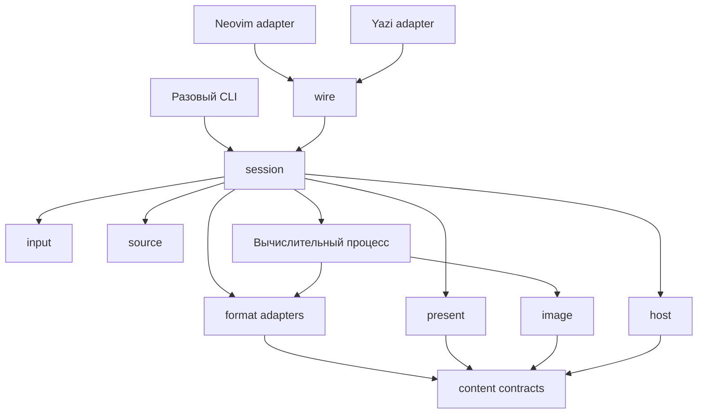
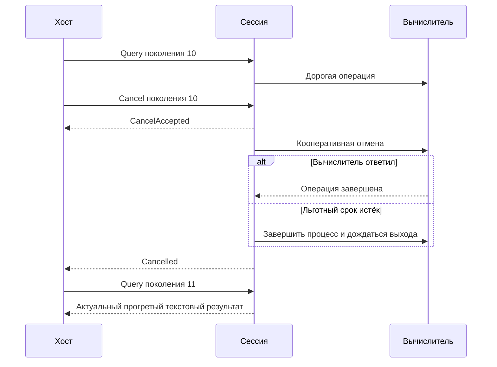

> Статус: исследовательский материал / предложение. Текущая реализация и команды
> описаны в [README.md](README.md), рабочие правила — в [AGENTS.md](AGENTS.md).
> Упоминание компонента здесь не означает, что он реализован.

# ii · Целевая архитектура и проверяемые контракты

Статус — проект для утверждения. Дата — 23 ноября 2026 года. Документ задаёт самостоятельную архитектуру и заменяет прежнее предложение при последующем утверждении. Числовые бюджеты ниже являются начальными настройками для проверки. Достижение этих значений реализацией предстоит подтвердить.

### Условия реализации после сверки требований

ASTRA.md задаёт требования к качеству и стилю разработки. ARCHITECTURE.md служит историей исследования. Технические контракты настоящего документа имеют приоритет при их несовпадении с прежним архитектурным предложением. Требование zero-copy распространяется на заимствование неизменяемых данных внутри процесса. Передача между изолированными процессами, декодирование строк и изображений требуют собственного хранения, которое учитывается в бюджете. Нулевые аллокации проверяются для отдельно названной прогретой операции.

Полная реализация сессии пока требует завершения следующих контрактов.

| Пробел | Что необходимо определить до подключения рабочего пути |
|---|---|
| Передача интерпретации из вычислителя | Формат нормализованных элементов и арены, проверка всех диапазонов, принадлежность байтов и учёт одновременно существующих копий. Сырой локальный AST через границу процесса не передаётся. |
| Отмена во время доставки | Перед отправкой CancelAccepted удаляются ещё не начатые рамки отменённого результата. Одна начатая рамка дописывается целиком. Уже переданные рамки отбрасываются получателем по поколению. Терминальное сообщение обязано помещаться в управляющий резерв. |
| Контроль потока | Необходимо закрепить вид подтверждения рамки, окно кредита для обоих направлений, обработку дубликатов и время ожидания. Ограниченный блокирующий кодек сам по себе этого контракта не выполняет. |
| Ограничение памяти | Резервация охватывает сериализованные и декодированные метаданные, планы и буферы ответа. Ограничения одного Store или одной рамки не являются общим бюджетом сессии. |

Состояние рабочего дерева после начатых изменений — общий путь графического рендера подключён к CLI и существующему демону. Модули source и wire пока являются проверяемыми примитивами. Сессия с отдельным вычислителем, кредитами и принудительной отменой к плагинам ещё не подключена. Приёмка целевой архитектуры требует проверки этих свойств через реальные точки входа.

## 1. Задача и границы продукта

ii предоставляет человеку и приложению доступное представление переданных данных. Он распознаёт поддерживаемую структуру, сохраняет значимые значения и отношения, выполняет необходимые преобразования и сообщает об ограничениях результата. Запрос может требовать текст, ограниченный preview или аннотации, связанные с исходником.

Наблюдаемые операции определяют следующую предметную область.

| Пример | Семантический статус | Обязанность системы |
|---|---|---|
| Формула в TeX, Markdown или notebook | Выражение с локальными правилами языка. Расширение файла определяет лишь один способ его передачи. | Сохранить выражение, выбрать поддерживаемый набор, показать исходную запись при локальном отказе. |
| ZIP или TAR | Контейнер с записями и метаданными. | Выдать достоверный перечень доступных записей и явно указать полноту инспекции. |
| Сжатый контейнер | Входной формат, для которого может быть доступен только заголовок. | Отличить сведения о контейнере от перечня его содержимого. |
| CSV/TSV | Последовательность записей и полей с правилами экранирования. | Сохранить пустые поля, границы записей и исходные значения. |
| Спецификация графика | Данные вместе с декларацией способа изображения. | Сообщить поддерживаемую часть декларации, сохранить доступные значения при отказе графики. |
| Markdown или notebook | Структурированный источник с порядком элементов. У вывода notebook могут быть несколько представлений одного значения. | Сохранить порядок и различать соседние элементы и альтернативы одного результата. |
| SVG и описание диаграммы | Готовое графическое описание и рецепт построения имеют разные правила обработки. | Применить соответствующий декодер или компилятор и ограничить ресурсы операции. |

Общий словарь состоит из источника, редакции, операции, происхождения, результата и полноты. Типы конкретных форматов остаются локальными. Путь относится к способу получения байтов. Окно относится к получателю. Идентификатор терминального изображения относится к внешнему ресурсу.

Исходные требования установлены наблюдаемыми входами CLI, получением буфера редактора, preview файлов и обработчиками форматов. Обязательность глобального демона, определённого IPC, универсальной графической сцены или постоянного кеша из этих операций не следует. [CLI](/Users/x0r/x/dev/own/ii/src/main.rs) · [Форматы](/Users/x0r/x/dev/own/ii/src/fmt/mod.rs) · [Neovim](/Users/x0r/x/dev/own/ii/plugins/ii.nvim/lua/ii/init.lua) · [Yazi](/Users/x0r/x/dev/own/ii/plugins/ii.yazi/main.lua)

Область текущего проекта включает чтение, интерпретацию и представление. Изменение пользовательского исходника, выполнение кода notebook, вычисление произвольных программ и извлечение архивов на диск требуют самостоятельных продуктовых решений. Полная совместимость с Quarto, Typst, Vega-Lite и Plotly устанавливается отдельно для каждого языка. Расширение файла само по себе не является обещанием полного исполнения языка.

## 2. Требования и инварианты

| ID | Требование | Проверка |
|---|---|---|
| R1 | Принимать файл, конечный снимок байтов и поток. | Путь с пробелами, ведущим дефисом и допустимыми для ОС байтами обрабатывается корректно. stdin работает без имени файла. |
| R2 | Сохранять смысл поддерживаемой части входа. | Совпадают значения, порядок, пустые элементы и альтернативы MIME. Усечение явно отмечено. |
| R3 | Давать воспроизводимую интерпретацию. | Одинаковые байты, подсказка типа, настройки и версия интерпретатора дают одинаковые семантические результаты. |
| R4 | Различать успешный, частичный, неподдерживаемый, ошибочный и отменённый исходы. | Пустой источник отличается от ошибки и от отсутствия графики. |
| R5 | Поддерживать независимые представления одной редакции. | Два окна разной ширины и темы получают корректные результаты. |
| R6 | Предотвращать публикацию устаревшего результата. | После правки, смены окна, отключения представления и перезапуска сессии старый ответ не применяется. |
| R7 | Ограничивать ресурсы во всём жизненном цикле. | Учтены входы, незавершённые загрузки, старые редакции, работа, кеш, транспорт, готовые ответы и внешние ресурсы. |
| R8 | Обеспечивать прекращение работы и освобождение ресурсов. | Отмена и закрытие получателя завершаются по определённым переходам состояния. |
| R9 | Поддерживать расширение форматов и получателей без копирования грамматики. | Новый получатель не разбирает Markdown, JSON notebook или TeX. |

Инварианты действуют во всех режимах исполнения.

- **Адресация.** Исходный диапазон — полуинтервал байтов конкретной редакции. Координаты ячеек и пикселей имеют отдельные типы. Декодированный текст JSON принадлежит отдельной арене, его происхождение указывает на поле исходного JSON. Точное посимвольное отображение требуется только операциям, которым оно действительно нужно.
- **Целостность.** Оконный результат относится к одному снимку и одному поколению запроса. Частичный результат допустим при явном статусе. Бинарный кадр принимается только целиком.
- **Полнота.** Статус относится к объявленной операции и области. «Прочитан заголовок» не означает «прочитан каталог». «Обработан viewport» не означает «проверен весь файл».
- **Владение.** У каждой аллокации и внешнего ресурса определён владелец. Передача владения изменяет учёт, копирование требует новой резервации.
- **Доверие.** Входные управляющие символы остаются данными. Терминальные команды создаёт адаптер из проверенных параметров. Просмотр не даёт входу права исполнять команды, обращаться к сети или выбирать путь записи.
- **Детерминизм.** Для сравнения пикселей дополнительно фиксируются шрифты, метрики, движок и настройки. Идентификаторы транспорта и терминала исключаются из сравнения содержимого.

Приоритеты качества — сохранность смысла, корректная публикация, ограниченные ресурсы, отзывчивость, затем пропускная способность. Отзывчивость управляющего канала, задержка готового preview и скорость массового экспорта измеряются отдельно. Нулевая аллокация формулируется для конкретной прогретой операции с достаточной ёмкостью буферов. Ориентир в 5 000 строк собственного производственного кода требует отчёта по Rust и Lua вместе. Размер зависимостей и количество поддерживаемых контрактов учитываются дополнительно.

## 3. Независимые оси архитектурных решений

| Ось | Варианты | Критерий выбора |
|---|---|---|
| Семантика обработки | Завершённые записи потока, снимок, инкрементальная редакция | Можно ли окончательно интерпретировать префикс и нужны ли повторные запросы? |
| Хранение | На время операции, на время сессии, постоянное | Как часто используются те же данные и окупаются ли хранение и инвалидация? |
| Граница исполнения | Вызов библиотеки, процесс хоста, отдельный вычислительный процесс | Кто отвечает за сбой, отмену и состояние пользовательского приложения? |
| Планирование | Последовательное, кооперативное, ограниченная параллельность | Есть ли операции переменной длительности, мешающие другим запросам? |
| Передача | Вызов функции, stdio, локальный сокет | Кто создаёт и завершает исполнителя, сколько независимых клиентов? |
| Представление | Текст, смешанные размещения, изображение области | Какие возможности подтверждены у получателя и сколько стоит каждый путь? |

### Сопоставимые конфигурации

Каждая конфигурация ниже описывает все основные оси. Семантические требования R1–R9 одинаковы.

| Конфигурация | Исполнение и состояние | Сильные стороны | Цена |
|---|---|---|---|
| A · Одноразовые преобразования | Процесс на операцию, память до завершения, поток там, где грамматика допускает. Снимок для остальных форматов. | Простой жизненный цикл, естественная изоляция запросов, воспроизводимость через CLI. | Повторный запуск и интерпретация при каждом resize или правке, ограниченный прогрев. |
| B · Сессия, принадлежащая хосту | Разовый CLI использует ядро напрямую. Редактор держит процесс с ограниченными снимками и кешем. Непрерываемые вычисления выполняет один сменяемый дочерний процесс. | Переиспользование редакции, независимость управления и дорогого вычисления, отсутствие общей службы для установки. | Контракт сессии, второй процесс для тяжёлой работы, учёт копий и очереди. |
| C · Общая локальная служба | Несколько клиентов через сокет, снимки и кеш под общей квотой, ограниченный пул вычислительных процессов. | Межклиентский прогрев, несколько тяжёлых работ одновременно. | Арбитраж клиентов, запуск и обновление службы, общий домен отказа координатора, более сложные квоты и безопасность. |
| D · Нативная библиотека в хостах | Библиотека в процессе каждого хоста, его рабочие потоки и память. | Прямой доступ к буферам, минимум межпроцессных копий. | FFI и упаковка для каждого хоста, общая судьба при аварии, ограниченная принудительная отмена. |

Для одиночных операций A имеет наименьшую стоимость сопровождения. B добавляет состояние именно там, где редактор многократно использует одну редакцию. C может выиграть при частых межклиентских повторах, но их доля пока неизвестна. D оправдан при доказанном доминировании передачи данных и приемлемой для продукта границе отказа.

**Проектный выбор — B для редакторской сессии и A для разового CLI.** Общие функции интерпретации и представления используются в обоих режимах. Файловый preview начинает с A, переход к сессии определяется отдельным сравнением. Выбор основан на наличии разовых запросов и несохранённых редакций, а также на необходимости прерывать отдельную дорогую операцию. Превосходство по задержке остаётся проверяемой гипотезой. Сравнение с C и D становится обязательным при появлении соответствующих нагрузок или требований.

## 4. Поток и снимок — два явных контракта

### Завершённый снимок

Снимок содержит фиксированную последовательность байтов. Его идентификатор действителен в пределах экземпляра сессии. Создание проходит состояния `Receiving → Sealed → Released`. Интерпретация снимка начинается после `Sealed`. После начала освобождения новые запросы отклоняются, существующие чтения удерживают данные до завершения.

Приём новой редакции резервирует её память до передачи тела. Предыдущая редакция остаётся действительной до успешного завершения загрузки. Ошибка или отмена загрузки освобождает только незавершённую редакцию. Одновременное существование старой, новой и читаемой редакций учитывается в общей квоте. При нехватке бюджета возвращается `ResourceLimit`, сохранение всех старых редакций не обещается автоматически.

Для файла снимком являются реально прочитанные байты. Повторные проверки метаданных могут обнаружить конкурентную запись, но не доказывают атомарность чтения чужого файла. Результат связывается с захваченными байтами. Более сильная согласованность требует предоставленного хостом снимка или отдельного механизма файловой системы. Поток неизвестного размера собирается до EOF в пределах лимита, если выбранный формат требует снимка.

### Поток завершённых записей

Поток имеет идентификатор операции, возрастающее смещение и состояние `Open → Ended | Failed | Cancelled`. Он не доступен через интерфейс запросов к снимку. Получатель получает только окончательные записи. Позднее изменение уже выданной записи запрещено контрактом потока.

| Формат или операция | Когда результат окончателен | Буферизация и EOF |
|---|---|---|
| Литеральный текст | После завершённой строки или безопасного участка UTF-8 | Хвост ограничен. На EOF выдаётся последний участок. Неверные байты обрабатываются заданной политикой замены или escaped-вывода. |
| CSV/TSV в режиме записей | После закрытия кавычек и завершения записи | Лимит одной записи. Выравнивание по максимуму всех будущих строк недоступно этому режиму. Используются фиксированные ограничения или подписанные поля. |
| Markdown с общей семантикой документа | Последующие определения могут влиять на ранее встреченный текст | Первая версия требует снимок. Событийный API парсера сам по себе не доказывает возможность выдачи окончательного префикса. |
| Notebook, график, отдельная формула, ZIP | Завершённость определяется соответствующей грамматикой и операцией | Первая версия требует снимок. Частичный обход контейнера можно добавить отдельной потоковой операцией с собственным контрактом. |

Автоопределение на ограниченном префиксе даёт подсказку. Для потокового синтаксического режима нужен однозначный формат или явное указание. Неоднозначный вход переводится в ограниченное накопление снимка либо в явно выбранное буквальное представление. Поздняя ошибка потока не отменяет уже выданный текст. Машинный выход получает итоговый статус, CLI — ненулевой код и диагностику в stderr.

## 5. Границы компонентов и данных

Один Rust-пакет содержит плоские модули. Названия обозначают обязанности, а не слои вызовов, через которые обязан проходить каждый байт.

| Модуль | Контракт | Владение |
|---|---|---|
| `input` | Файл или поток → ограниченные байты и события завершения | Дескрипторы и буферы приёма |
| `source` | Приём, завершение, чтение и отпускание снимка | Байты, идентификаторы редакций, аренда активными запросами |
| `format` и конкретные адаптеры | Снимок либо запись → локальная интерпретация и представимые элементы | Правила грамматики и необходимые локальные индексы |
| `content` | Малые структуры обмена, единицы координат, происхождение и полнота | Описание формы данных без ОС и кешей |
| `present` | Элементы, запрос и политика вида → ограниченный план результата | Переносы, размеры, исходные аннотации и видимая область |
| `image` | Рецепт графики и заданные размеры → пиксели или локальный отказ | Временные ресурсы движка |
| `session` | Состояния операций, квоты, очередь, отмена, повторное использование | Все учтённые ресурсы сессии |
| `wire` | Ограниченные рамки ↔ проверенные сообщения | Буферы транспорта и состояние сборки сообщения |
| `host` | Готовые строки, аннотации и размещения → эффекты получателя | Терминальные ресурсы или файлы доставки |

`session` координирует конкретные функции. Грамматика, алгоритм переноса и компиляция изображения в нём отсутствуют. Производственные зависимости направлены к контрактам данных. Адаптер формата может непосредственно вызывать нужный декодер. Дополнительный проход через центральный маршрутизатор для каждого вложенного элемента не требуется.

### Минимальная модель на границе представления

Локальные деревья Markdown, объекты notebook, записи архива и спецификации графиков не пересылаются всем компонентам. Каждый адаптер выдаёт упорядоченные элементы в буфер вызывающего кода или ограниченными порциями.

| Элемент | Содержимое | Кто нормализует |
|---|---|---|
| Текстовый блок | Срезы текста, inline-роли, тип блока, отступ и происхождение | Адаптер языка |
| Таблица | Порядок записей, поля, необязательный заголовок, выравнивание и полнота | CSV или адаптер каталога контейнера |
| Графический объект | Закрытый вид рецепта, ссылка на байты, inline/block, известные размеры, доступное текстовое представление | Адаптер исходного формата |
| Альтернативы одного результата | Упорядоченный ограниченный набор текстовых и графических кандидатов с общей идентичностью результата | Notebook или иной формат с альтернативами |
| Диагностика | Категория, происхождение, тяжесть и доступный fallback | Этап, обнаруживший ограничение |

Ссылка на текст содержит владельца арены, смещение и длину. Источник и декодированный текст имеют разных владельцев. Ограниченные плоские массивы хранят строки таблицы и inline-участки. Граф произвольных объектов и динамические посетители для этой границы не требуются.

`present` выполняет ограниченное число операций над этими элементами — последовательный экспорт, раскладку области и выдачу аннотаций. Оно не ветвится по расширению файла. Обработка `csv`, `markdown` и `notebook` в этом модуле означала бы нарушение границы. Сложный формат сначала нормализует свои данные в адаптере.

Политика альтернатив выбирает один доступный кандидат для одного результата. При отказе графики пробуется следующий допустимый кандидат, причина сохраняется. Диагностическое сообщение не создаёт вторую копию успешного представления. Если новый формат требует действительно нового типа элемента, изменение `content` и получателей оформляется как расширение контракта с отдельными тестами.

Пример расширения — каталог нового контейнера требует нового читателя и выбора формата. Его строки нормализуются в таблицу. Планировщик, перенос строк, протокол и плагины остаются потребителями уже определённых контрактов.

## 6. Интерфейс сессии и согласованность

При установлении соединения стороны согласуют версию протокола и пределы. Сервер выдаёт новый `session_id`. Идентификаторы источников, запросов и ресурсов действуют только с ним. Внутри сессии идентификаторы не переиспользуются. Перезапуск исключает принятие ответов от прежнего процесса.

| Операция | Параметры | Результат |
|---|---|---|
| `BeginSource` | Источник, редакция хоста, длина, подсказка формата | Резервация и разрешение на передачу либо `ResourceLimit` |
| `SourceChunk` | Идентификатор загрузки, смещение, байты | Приём непрерывного участка в пределах разрешённого объёма |
| `SealSource` | Идентификатор загрузки | После проверки точной длины создаётся неизменяемый снимок |
| `Query` | Снимок, запрос, окно/получатель, поколение, вид результата, область, метрики, тема, возможности и срок | Принятие в ограниченную очередь либо явный отказ |
| `Cancel` | Идентификатор загрузки или запроса | Подтверждение принятия отмены, затем терминальный статус |
| `ReleaseSource` | Идентификатор снимка | Закрытие для новых запросов и освобождение после завершения читателей |
| `ReleaseResult` | Идентификатор ресурса доставки | Освобождение предоставленного файла или буфера после потребления |
| Закрытие канала | Событие транспорта | Отмена всех работ клиента, освобождение ссылок и ресурсов |

Запрос проходит `Queued → Running → Delivering → Completed`. Из промежуточных состояний допустимы `Failed` и `Cancelled`. Подтверждение `CancelAccepted` означает, что новые части результата больше не планируются. Оно отличается от `Cancelled`, который означает завершение вычисления и освобождение удерживаемых им ресурсов. Уже переданные части нельзя отозвать по каналу.

Если запрос завершился раньше обработки отмены, приходит `AlreadyFinished`. Хост всё равно применяет свою проверку поколения. Отмена не позволяет позднему ответу восстановить удалённую декорацию.

Перед публикацией хост сверяет `(session_id, source_revision, recipient_id, generation)` и собственное состояние включения представления. Поколение увеличивается при смене области, метрик, темы, активности получателя и закрытии. Новая редакция источника отдельно меняет `source_revision`. Два окна одного буфера имеют разные `recipient_id`.

Оконный результат собирается под ограничением размера и публикуется после `ResultEnd`. Текстовый экспорт допускает порции с итоговым статусом. На EOF незавершённый бинарный ответ считается ошибкой. Потребитель не отображает его как успешный кадр.

## 7. Транспорт, управление потоком и отмена

Разовый вызов ядра обходится без сериализации. Для редакторской сессии предлагается stdio с ограниченными рамками. Выбор JSON для небольших метаданных обусловлен доступностью декодеров в Rust и Lua и возможностью воспроизвести запрос. Байтовое тело передаётся отдельно. Оптимизация формата метаданных требует измерения его доли в задержке.

Начальная рамка состоит из фиксированного префикса с версией, длиной метаданных и длиной тела, затем JSON-метаданных и байтов. Конкретная разметка префикса фиксируется в спецификации wire перед реализацией и покрывается общими тестовыми векторами. Префикс задаёт ограничение до разбора JSON.

- Максимум метаданных одной рамки — 4 КиБ, тела — 64 КиБ. Глубина и число полей JSON также ограничены. Суммарные длины проверяются без переполнения. Неизвестная версия и неверная рамка закрывают соединение с ограниченной диагностикой.
- Большой источник или изображение передаётся последовательностью рамок. Получатель сначала разрешает суммарный объём операции и резервирует память. Отправитель держит не более двух неподтверждённых рамок данных в одном направлении соединения, включая все операции.
- Управляющие рамки имеют отдельный небольшой резерв очереди и выбираются перед очередной рамкой данных. Они не потребляют кредит данных. Уже начатая рамка дописывается целиком. Отмена может ожидать текущую рамку и уже отправленные рамки, но не весь многомегабайтный снимок.
- Чтение и запись обслуживаются независимо неблокирующим вводом-выводом. Исполнитель не удерживает общую блокировку во время записи. Готовый большой ответ остаётся в ограниченном хранилище результата, а не дублируется целиком в очереди сокета или pipe.
- Частичный заголовок, частичное тело, отсутствие продвижения и длительность доставки имеют сроки. По истечении срока соединение закрывается, привязанные операции отменяются. Если ОС или хост не планирует процесс, конечную миллисекундную задержку доставки подтвердить невозможно. Проверяемый транспортный предел задаётся числом байтов впереди управления и испытанием задержки на выбранной системе.
- Превышение выходного лимита обнаруживается до публикации оконного кадра. Для потокового экспорта допустим уже выданный префикс с итогом `Partial(ResourceLimit)`.

Медленный читатель удерживает только разрешённые рамки, один принятый результат и ограниченную работу. Новые запросы при исчерпании квоты получают отказ либо заменяют ещё не начатый запрос того же получателя. Процесс не наращивает очередь ради сохранения каждого промежуточного resize.

## 8. Исполнение и изоляция

В редакторском режиме процесс сессии обслуживает управление, квоты, снимки и кеш. Его цикл выполняет только ограниченные действия. Копирование больших данных и обход элементов дробятся на участки с возвратом в цикл. Грамматики и библиотеки с непредсказуемой длительностью исполняются в одном вычислительном дочернем процессе. Он запускается лениво и обслуживает одну работу за раз.

Прогретый запрос к уже полученному плану и текстовым элементам может быть обработан кооперативно в процессе сессии. Полный разбор нового Markdown и дорогая растеризация туда не попадают. Внутренний протокол вычислителя использует те же ограничения рамок, но имеет узкий словарь задач.

| Ситуация | Политика |
|---|---|
| Несколько ожидающих запросов одного окна | Сохраняется последний. Заменённый получает терминальный статус отмены. |
| Ожидающие запросы разных окон | Очередь обслуживается по кругу, с проверкой срока до старта. Время ожидания и вычисления учитываются отдельно. |
| Дорогой запрос выполняется, пришёл прогретый текстовый | Текстовый путь обслуживается в процессе сессии с собственным ограничением работы. |
| Дорогой запрос выполняется, пришёл ещё один дорогой | Он ожидает до освобождения исполнителя или собственного срока. Нулевая задержка для этого случая не обещается. |
| Отмена работающего запроса | Сначала кооперативная отмена. После льготного интервала процесс вычислителя завершается и reap выполняется родителем. Остальные снимки и кеш сессии сохраняются. |
| Авария вычислителя | Запрос получает `EngineFailure`. Вычислитель пересоздаётся для следующей допустимой задачи. Автоповтор того же падающего ввода отсутствует. |

Предварительные параметры — до восьми ожидающих запросов сессии, один на получателя, один вычислитель, 50 мс льготного интервала отмены. Для интерактивной тяжёлой работы первоначальный срок — 2 с, для явного полного экспорта — 30 с с возможностью настройки. По истечении срока доступный текстовый fallback возвращается с причиной. Эти значения проверяются на сложных допустимых примерах и при необходимости меняются явно.

Разовый CLI может выполнять обработку непосредственно в своём процессе, поскольку отмена завершает именно эту операцию. Файловый хост владеет запущенным процессом и задаёт срок. Исполнитель не создаёт внешних программ без отдельного адаптера с управлением дочерними процессами.

## 9. Единый учёт ресурсов

Бюджет определяется на уровне владельца сессии. В него входят снимки, загрузки, локальные индексы, нормализованные элементы, планы, кешированные изображения, транспортные буферы, ожидающие ответы и известная память задач. Лимит числа элементов дополняет байтовый предел.

Перед выделением буфера резервируется его ёмкость. Учитывается `capacity`, а не только длина полезных данных. Резервация живёт вместе с владельцем буфера и освобождается при его уничтожении или уменьшении. Один совместно используемый буфер учитывается один раз. Копия в вычислительном процессе и копия на принимающей стороне учитываются отдельно в соответствующих бюджетах.

Начальные пределы являются конфигурацией для испытаний.

| Ресурс | Начальное значение | Исчерпание |
|---|---|---|
| Учтённые живые данные сессии, включая известные копии в вычислителе | 256 МиБ | Удаление свободных производных данных, затем отказ в новой резервации |
| Один источник и один незавершённый приём | 32 МиБ | Отказ загрузки с сохранением ранее принятой редакции |
| Сумма входных снимков и загрузок | 128 МиБ внутри общего бюджета | Отказ в новом входе, без удаления читаемого снимка |
| Производные данные | 64 МиБ внутри общего бюджета | Вытеснение неиспользуемых записей. Крупный результат выполняется без кеширования только при доступном общем бюджете |
| Один доставляемый результат | 32 МиБ | Локальное сокращение с признаком полноты либо отказ операции |
| Активные источники и сохранённые редакции | До 16 источников, до двух редакций на источник | Требуется отпускание старой редакции. Активное чтение продолжает удерживать её и квоту |
| Файлы доставки | 64 МиБ на сессию, отдельная дисковая квота | Ошибка доставки с доступным fallback |

Частные лимиты вложены в общий и не суммируются в разрешение превысить его. Память кода, стеки, аллокатор и неучтённые внутренние аллокации библиотек измеряются отдельно через RSS. Учёт собственных буферов не даёт строгой верхней границы RSS.

Для стороннего декодера сначала проверяются доступные размеры и входные ограничения. Вычислительный процесс получает лимит ОС там, где соответствующий механизм поддержан и проверен. Иначе действует контроль RSS и принудительное завершение с возможным кратковременным превышением между измерениями. Строгая гарантия для произвольного декодера заявляется только для проверенного механизма ОС. Неподдерживаемый строгий режим отклоняется явно.

Постоянный кеш отсутствует в начальной конфигурации. Ключ производного изображения включает содержимое, тип преобразования, настройки, версию движка, размеры и влияющие визуальные параметры. Адрес размещения входит только тогда, когда меняет сами пиксели. Терминальный идентификатор выделяется адаптером в своей области владения и не служит доказательством равенства содержимого.

## 10. Представление, геометрия и интеграции

Запрос задаёт единицы области явно. Для редактора это исходный диапазон, для ограниченного preview — визуальные строки при фиксированной ширине, для полного экспорта — последовательность до конца входа. Изменение ширины инвалидирует индекс визуальных строк. Хост сохраняет исходный якорь верхнего элемента, чтобы восстановить положение после перераскладки.

Представление использует естественный размер графики, если он уже известен или дёшево измеряется. В противном случае политика конкретного preview задаёт ограниченную зарезервированную область. Объект вписывается с сохранением пропорций. Резервирование применяется к этому графическому элементу и не превращает весь документ в картинку. Для inline-математики, размеры которой влияют на строку, завершение кадра ожидает измерение или использует текстовый fallback. Это исключает обещание точной inline-геометрии до получения необходимых метрик.

Тема определяет цветовые и типографические значения семантических ролей. Обработчики языка выдают роли. Графические компиляторы получают разрешённые визуальные параметры явно. Зависимость изображения от темы отражается в ключе кеша. Отсутствующий глиф имеет текстовую замену. Табличная ширина вычисляется в ячейках, адреса редактора остаются байтовыми. Политика неоднозначной ширины Unicode фиксируется вместе с профилем получателя.

### Выбор способа вывода

| Получатель | Базовый контракт | Что требует проверки до закрепления |
|---|---|---|
| Shell и fzf | Читаемый текст, ANSI по явному запросу, stderr для диагностики | Unicode, корректное завершение pipe, отсутствие бинарного служебного префикса в обычном тексте |
| Терминал с графикой | Текстовые участки и отдельные графические размещения по подтверждённым возможностям | Геометрия, очистка, мультиплексор, удалённый сеанс и поведение после сброса терминала |
| Neovim | Исходные привязки и отдельное состояние окна, применение только актуального поколения | Два окна одного буфера, скролл, conceal, редактирование, отключение и очистка ресурсов |
| Yazi | Ограниченный ответ на актуальный запрос, текст через виджет | Возможность смешанного вывода, срок жизни изображений и передача графики через поддерживаемый API |

Для Yazi сравниваются три конкретных реализации — нативный текст с отдельными изображениями, текст с обозначенными графическими объектами и изображение видимой области. Последний вариант требует полноценного шрифтового пути и измерения повторной растеризации при прокрутке. Он утверждается только после сравнительного опыта по полноте, читаемости, задержке, памяти и размеру собственной реализации. Если обязательная смешанная графика недоступна выбранным API, интеграция сохраняет статус неполной до выбора рабочего способа. Текстовая деградация остаётся допустимым режимом, но не засчитывается как успешное прохождение графического сценария.

Доступность API сама по себе не устанавливает корректность всей интеграции. В испытании фиксируются версии хостов. Официальные контракты служат основанием для проверки конкретных вызовов. [Neovim API](https://github.com/neovim/neovim/blob/master/runtime/doc/api.txt) · [Yazi API](https://yazi-rs.github.io/docs/plugins/utils/) · [Kitty graphics](https://sw.kovidgoyal.net/kitty/graphics-protocol/)

## 11. Отказы, внешние ресурсы и наблюдаемость

| Отказ | Реакция | Восстановление |
|---|---|---|
| Неизвестный формат | `Unsupported`, безопасное буквальное представление по запросу | Явная подсказка формата или установка поддерживающего выпуска |
| Ошибка локального элемента | Диагностика с происхождением, доступная альтернатива, частичная полнота | Остальная последовательность продолжает обрабатываться |
| Превышение лимита | `ResourceLimit` с видом лимита и областью | Повтор только после изменения запроса или бюджета |
| Повреждённая рамка | Завершение соединения и очистка принадлежащих ему работ | Новая сессия и полная передача нужных снимков |
| Тайм-аут вычисления | Отмена конкретной задачи и завершение вычислителя при необходимости | Следующая задача получает новый вычислитель |
| Сбой сессии | Хост снимает её ресурсы, помечает все запросы завершёнными с ошибкой | Один автоматический перезапуск. Повторный сбой отключает автоповтор до явного действия пользователя |
| Медленный получатель | Остановка выдачи сверх кредита и ограниченное ожидание | По истечении срока закрытие канала |
| Ошибка графического транспорта | Снятие невалидного размещения и текстовый fallback | Повторное определение возможностей при новой сессии |

Файл изображения создаётся в частном каталоге с именем приложения. Он удерживается до подтверждённого потребления или до замены/закрытия соответствующего preview, если API читает асинхронно и не даёт более раннего подтверждения. При падении хоста процесс сессии очищает свои файлы. Для аварийного завершения обоих процессов следующий запуск удаляет только явно принадлежащие приложению каталоги завершённых сессий, проверяя владение и исключая симлинки. Очистка не следует путям, полученным из содержимого источника.

Адаптер терминала ведёт ограниченный набор собственных размещений и удаляет их при замене и штатном закрытии. После аварии гарантировать отсутствие пикселей в чужом терминальном процессе без его участия невозможно. При восстановлении адаптер переинициализирует свой домен ресурсов. Глобальное удаление чужих изображений запрещено контрактом владения.

Процессная изоляция локализует сбой, но права пользователя наследуются. Декодеры получают байты и контролируемый загрузчик ресурсов. Внешние URL, исполняемый код и произвольное чтение вложенных путей отключены по умолчанию. Шрифты и разрешённые ресурсы предоставляются конфигурацией приложения. Изображения и сжатые данные ограничиваются по декодированному объёму и глубине. Расширение прав требует самостоятельного решения.

Диагностика содержит код, этап, источник в пределах сессии, время и достигнутый лимит. Обычные журналы исключают содержимое и полные пути. По явному запросу собирается локальная трасса метаданных. Счётчики включают ожидание, вычисление, передачу, публикацию, отмены, повторы, попадания в кеш, зарезервированные байты и максимальный RSS. Отмены при быстрой навигации учитываются отдельно от ошибок.
