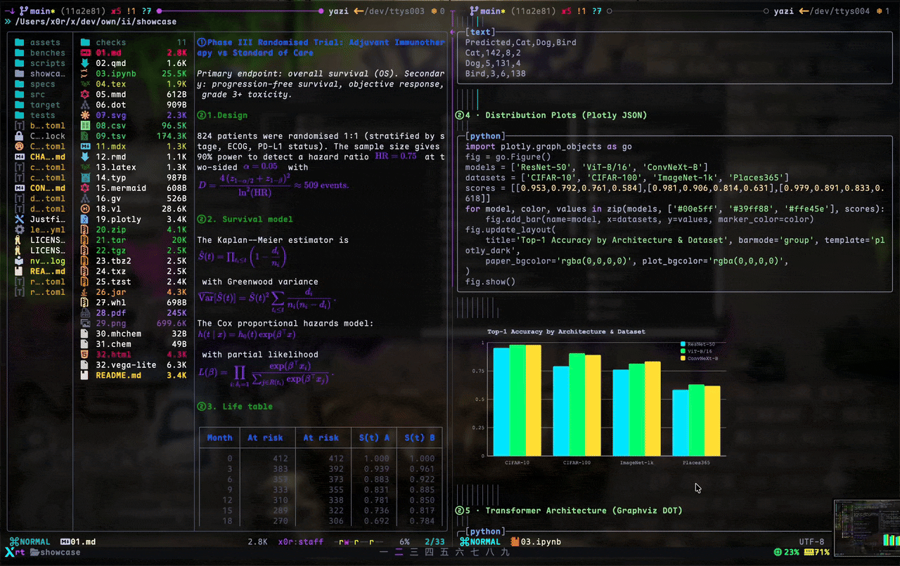
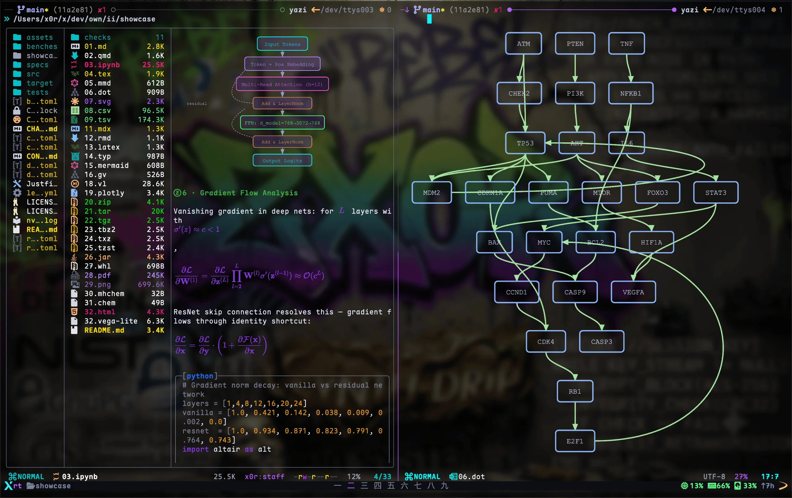
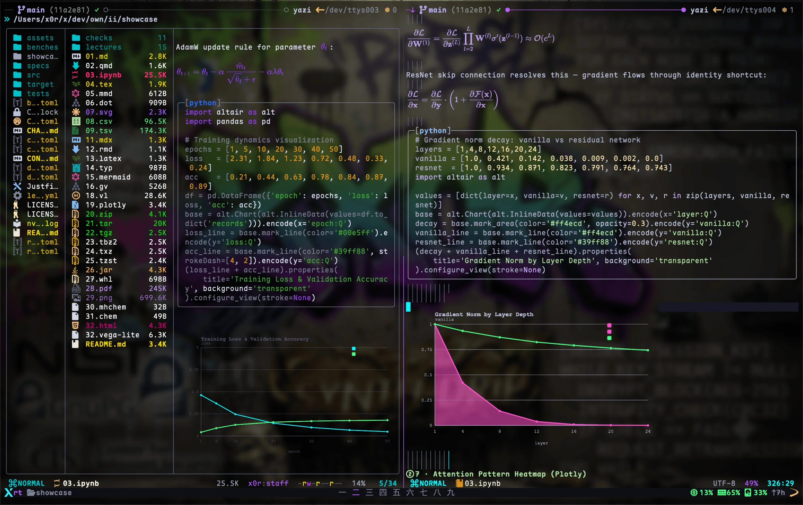
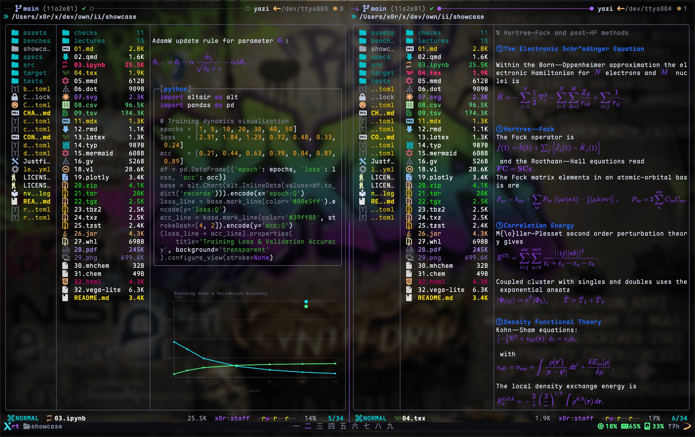

<p align="center">
  <a href="https://github.com/zx0r/ii/releases">
    
  </a>
  <a href="LICENSE-MIT">
    
  </a>
  <a href="https://www.rust-lang.org/">
    
  </a>
  <a href="https://specifications.freedesktop.org/basedir-spec/basedir-spec-latest.html">
    
  </a>
</p>

<p align="center">
  <a href="assets/video/ii-demo.mp4">
    
  </a>
</p>

<p align="center">
  
</p>

<p align="center">
  
</p>

<p align="center">
  
</p>

# Terminal Graphical Coprocessor

---

### Installation

```bash
# Cargo (crates.io)
cargo install --locked ii

# Homebrew (macOS / Linux)
brew install zx0r/tap/ii

# Build from source (LTO fat, stripped)
gh repo clone zx0r/ii
cd ii && just release
```

---

### CLI Reference

```bash
# Render document to Kitty terminal
ii README.md

# Render specific size / cells
ii --size <size> <target>

# Pipe from stdin
cat <target> | ii
```

### Integrations

#### Yazi ([ii.yazi](https://github.com/zx0r/ii.yazi))

```sh
# 1. Install
ya pkg add zx0r/ii
```

```toml
# 2. Configure $HOME/.config/yazi/yazi.toml
[plugin]
# Background preloader: caches rendered frames before cursor navigation
prepend_preloaders = [
  { url = "*.{md,markdown,mdx,qmd,rmd,ipynb,mmd,mermaid,dot,gv,svg,svgz,tex,latex,typ,typst,chem,mhchem,html,htm,csv,tsv,vl,vega,vega-lite,plotly,zip,jar,whl,tar,tgz,tbz2,txz,tzst}", run = "ii" },
]

# Tier 0 previewers: high-priority graphic coprocessor
prepend_previewers = [
  { url = "*.{md,markdown,mdx,qmd,rmd}", run = "ii" },
  { url = "*.ipynb",                     run = "ii" },
  { url = "*.{tex,latex,typ,typst}",     run = "ii" },
  { url = "*.{mmd,mermaid,dot,gv,svg,svgz,vl,vega,vega-lite,plotly,chem,mhchem,html,htm}", run = "ii" },
  { url = "*.{csv,tsv}",                 run = "ii" },
  { mime = "application/{*zip,tar,x-tar,gzip,x-bzip2,x-xz,zstd,java-archive}", run = "ii" },
  { url = "*.{zip,jar,whl,tar,tgz,tbz2,txz,tzst}", run = "ii" },
]
```

#### Neovim ([ii.nvim](https://github.com/zx0r/ii.nvim))

```lua
{
  "zx0r/ii.nvim",
  ft = {
    "markdown", "markdown.mdx", "md", "mdx", "quarto", "qmd", "rmd", "ipynb",
    "html", "htm", "tex", "plaintex", "latex", "typst", "typ",
    "mermaid", "mmd", "dot", "gv", "svg", "svgz", "png", "csv", "tsv",
    "plotly", "vl", "vega", "vega-lite", "chem", "mhchem",
    "zip", "jar", "whl", "tar", "tgz", "tbz2", "txz", "tzst",
  },
  cmd = { "Ii", "IiRender", "IiToggle", "IiClear", "IiPreview" },
  keys = {
    { "<leader>pr", "<cmd>IiRender<cr>",  desc = "ii: Render buffer" },
    { "<leader>pt", "<cmd>IiToggle<cr>",  desc = "ii: Toggle KGP rendering" },
    { "<leader>pc", "<cmd>IiClear<cr>",   desc = "ii: Clear decorations" },
    { "<leader>pp", "<cmd>IiPreview<cr>", desc = "ii: Instant preview" },
  },
  opts = {
    -- 10ms debounce tuned for Apple ProMotion 120Hz displays (8.33ms frame window)
    debounce_ms = 10,
    -- IPC deadline timeout for complex multi-node vector charts
    timeout_ms = 3000,
  },
}
```

---

### [ i i ]

<p align="center">
  
</p>

```shell
ii [FILE]

[✓] zero-copy streaming pipeline
[✓] hardware-accelerated Kitty graphics protocol
[✓] sub-millisecond math, diagram, chart synthesis
[✓] zero-allocation layout & terminal cell metrics

you open files → we render pixels instantly
you navigate buffers → we decorate without stutter
```

---

### License

Dual-licensed under [MIT](LICENSE-MIT) or [Apache 2.0](LICENSE-APACHE).
