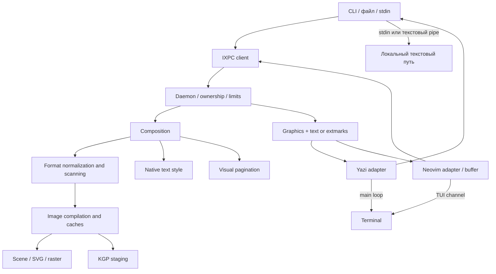

# ii

Терминальный просмотр технических документов, формул, диаграмм, таблиц и сохранённых результатов
вычислений. Обычный текст остаётся текстом; математические и графические блоки выводятся через Kitty
Graphics Protocol. Есть интеграции с Yazi, Neovim и fzf.

Состояние документа: 23 ноября 2026 года. Версия пакета: `0.1.0`. Лицензия: MIT OR Apache-2.0.

## Манифест

Просмотр должен сохранять содержание и оставаться отзывчивым при скролле, смене файла, темы и
размера окна. Красивый кадр не оправдывает пропавшую формулу, повреждённый ввод или неограниченное
потребление памяти.

- **Нативный текст и настоящая графика.** Не растеризовать документ целиком ради удобства
  реализации. Не имитировать глифы прямоугольниками.
- **Один владелец каждой ответственности.** Форматы интерпретируют данные, композиция сохраняет
  порядок, хост управляет вводом и публикацией кадра.
- **Прозрачность.** Служебные подложки не перекрывают фон терминала. Палитра и маркеры соответствуют
  Catppuccin Mocha/Latte исторического `ii_old`.
- **Скорость с доказательствами.** Сравнивать одинаковое полезное поведение, публиковать единицы,
  корпус, количество блоков и ограничения измерения.
- **Минимальная достаточная сложность.** Абстракции и зависимости должны решать существующую задачу.
  Число модулей и паттернов не является показателем качества.
- **Честные границы.** Поддержка расширения не означает исполнение полного языка. Ниже перечислены
  ограничения, включая неустранённые архитектурные издержки.

## Быстрый запуск

Нужны Rust **1.100+**, Cargo и Unix-платформа. Проверенная среда — macOS arm64; Linux является
целевой Unix-средой, но этот документ не объявляет все Linux- и SSH/tmux-комбинации проверенными.
Windows не поддерживается текущим Unix transport. Наличие Windows target в toolchain-конфигурации не
меняет это ограничение.

Для графики нужен терминал с поддержкой Kitty Unicode placeholders. Для исторических иконок нужен
Nerd Font; отсутствие такого шрифта может дать квадраты вместо маркеров. Обычная текстовая выдача
работает без графического терминала.

```sh
cargo +stable build --locked --release
./target/release/ii --help
./target/release/ii doctor
./target/release/ii --size 100x30 -- showcase/01.md
./target/release/ii --size 100x30 --skip 30 -- showcase/01.md
```

Чтобы использовать бинарник без копирования в системные каталоги:

```sh
export PATH="$PWD/target/release:$PATH"
```

При перенаправленном stdout по умолчанию выдаётся безопасный текст исходника. `--ansi` включает
оформление текста. Для графического кадра адаптера предназначен `--machine`, а не обычное
перенаправление stdout.

```sh
printf '# Example\nText with **emphasis**.\n' | ii --ansi
# Двоичная рамка адаптера: её нельзя выводить через cat в терминал.
ii --machine --size 80x24 --cell-size 9x18 -- showcase/01.md > /tmp/ii-frame.bin
```

`ii` не редактирует просматриваемые файлы и не исполняет код документа.

## Форматы и границы поддержки

Полный документ обрабатывает `compose::render_file`; диспетчер Scene обслуживает графическую часть.
Эта разница существенна для текста, notebook и CSV.

| Вход                             | Реализованное поведение                                                                            | Граница                                                               |
| -------------------------------- | -------------------------------------------------------------------------------------------------- | --------------------------------------------------------------------- |
| `.md`, `.markdown`               | Нативный текст, заголовки, задачи, callouts, таблицы, code fences; графические spans               | Поддерживаемый Markdown-поднабор, не браузер                          |
| `.mdx`, `.qmd`, `.rmd`           | Текстовый путь и распознаваемые графические/математические блоки                                   | JavaScript, R, Quarto/Pandoc-процессинг не исполняются                |
| `.typ`, `.typst`                 | Заголовки, таблицы и математическая нотация Typst через общий TeX-компилятор                       | Не полноценный компилятор Typst                                       |
| `.tex`, `.latex`                 | Математика ratex; нормализация preamble, section headings и math delimiters                        | Не TeX distribution: нет полного article/layout/packages/bibliography |
| `.chem`, `.mhchem`               | Химические выражения через mhchem в ratex                                                          | В пределах реализации библиотеки                                      |
| `.mmd`, `.mermaid`               | Mermaid → SVG → RGBA с прозрачной темой                                                            | В пределах mermaid-svg, не произвольный Mermaid JS runtime            |
| `.dot`, `.gv`                    | Встроенный разбор и раскладка графа                                                                | Поднабор DOT; системный Graphviz не вызывается                        |
| `.svg`                           | SVG через resvg, настоящие текстовые глифы и тематизация                                           | В пределах resvg; ресурсные ограничения действуют                     |
| `.png`                           | Декодирование, масштабирование и прозрачное дополнение до ячеек                                    | Собственные непрозрачные пиксели изображения сохраняются              |
| `.csv`, `.tsv`                   | Нативные полноширинные таблицы; экранирование, пустые поля, quoted newline                         | Векторный parser имеет собственный ограниченный Scene-путь            |
| `.vl`, `.vega-lite`, `.plotly`   | Bar, line, area, scatter, pie из inline JSON; Plotly heatmap до 64×64; заголовки, оси и до 4 рядов | Частичные спецификации; не полный Vega/Plotly runtime                 |
| `.ipynb`                         | Markdown, код, stream/error, сохранённые MIME SVG/PNG/LaTeX/Markdown/графики                       | Kernel не запускается; поддерживаются выбранные MIME alternatives     |
| `.zip`, `.jar`, `.whl`, `.tar`   | Нативное дерево каталогов и файлов                                                                 | Просмотр без извлечения; ограниченный список записей                  |
| `.tgz`, `.tbz2`, `.txz`, `.tzst` | Декодирование и дерево вложенного TAR/ZIP                                                          | До 64 MiB распакованных данных; без shell и извлечения                |

Kind определяется расширением и ограниченным sniffing содержимого. `.json` не является
самостоятельным обещанием поддержки любого JSON-документа. Шрифты TTF/OTF, SVGZ, PDF, 7z/RAR/ISO и
произвольные офисные форматы не заявлены. Не направляйте их в ii только из-за наличия такого правила
в старой личной конфигурации.

## CLI и фоновой процесс

| Параметр                    | Назначение                                            |
| --------------------------- | ----------------------------------------------------- |
| `--size WxH`, `-s WxH`      | Размер viewport в ячейках                             |
| `--cell-size WxH`           | Физический размер ячейки в пикселях                   |
| `--skip N`                  | Смещение в визуальных строках после переносов         |
| `--theme dark\|light`, `-t` | Палитра                                               |
| `--ansi`                    | Оформленный текст для pipe                            |
| `--machine`                 | Двоичная рамка `[u32 apc_len LE][graphics][text]`     |
| `--daemon`                  | Запустить IXPC-процесс                                |
| `--socket PATH`             | Использовать отдельный Unix socket                    |
| `--ping`, `--shutdown`      | Проверка и штатное завершение процесса                |
| `doctor`                    | Диагностика метрик, темы, кэша и доступности процесса |
| `--`                        | Конец параметров перед именем файла                   |

Файловое графическое превью обращается к постоянному процессу. На холодном запуске CLI пытается его
запустить; скролл повторно использует подготовленный документ. Сокет по умолчанию:
`$XDG_RUNTIME_DIR/ii/ii.sock`, иначе `/tmp/ii-<uid>/ii.sock`. Каталог сокета проверяется и
ограничивается правами владельца. Изолированный запуск:

```sh
mkdir -p /tmp/ii-demo-private
chmod 700 /tmp/ii-demo-private
ii --daemon --socket /tmp/ii-demo-private/ii.sock
# В другом терминале:
ii --ping --socket /tmp/ii-demo-private/ii.sock
ii --shutdown --socket /tmp/ii-demo-private/ii.sock
```

Фоновый процесс завершает ожидание после периода простоя; это не системный сервис. `ii init` и
`ii --mode daemon` не являются командами текущего CLI.

## Интеграции

### Yazi

```sh
mkdir -p ~/.config/yazi/plugins/ii.yazi
cp plugins/ii.yazi/main.lua ~/.config/yazi/plugins/ii.yazi/main.lua
```

Добавьте правила из `plugins/yazi/yazi.toml` в существующий `[plugin]`, не создавая второй
одноимённый TOML-раздел. `ii` должен быть на PATH. После обновления Lua-файла перезапустите Yazi.
[Контракт адаптера](plugins/ii.yazi/README.md).

Yazi получает framed output CLI. Графика публикуется в основном цикле через `ya.sync` только после
проверки актуальности файла и смещения. Вывод в TTY из дочернего процесса удалён: он воспроизведённо
пересекался с перерисовкой интерфейса. Каждый KGP continuation содержит `q=2`, чтобы ответы
терминала не попадали во ввод. Preload не рисует: фоновый запрос не должен портить чужое активное
превью.

### Neovim

Нужен **Neovim 0.12+**: публикация использует упорядоченный `nvim_ui_send`.

```lua
vim.opt.runtimepath:append('/absolute/path/to/ii/plugins/ii.nvim')
require('ii').setup({
  executable = '/absolute/path/to/ii/target/release/ii',
  debounce_ms = 20,
  timeout_ms = 5000,
})
```

Команды: `IiRender`, `IiToggle`, `IiClear`. Normal показывает подготовленные декорации поверх
исходного буфера. Плагин не перехватывает клавиши и не переключает режимы: Insert/Replace открывают
исходник, InsertLeave обновляет декорации. Скролл и движение мыши используют готовые блоки.
Plotly/Vega-Lite, CSV/TSV и notebook направляются в свои обработчики по формату несохранённого
буфера. Окна имеют отдельные кадры и ширину. [Подробности](plugins/ii.nvim/README.md).

### fzf и Kitty

`source plugins/fzf/fzf.sh` задаёт текстовое ANSI-превью fzf. Это не графическая публикация через
Yazi/Neovim. `plugins/kitty/kitty.conf` — необязательная подсказка, не обязательное включение remote
control или изменение задержек терминала.

## Действующая архитектура

Архитектурный стиль — компактный модульный процесс: данные и функции на явных границах, закрытый
enum форматов, отдельные адаптеры хостов. Универсальный plugin framework, второй wire-протокол и
абстрактный service layer не требуются.



Схема показывает основные исполняемые пути; локальная графическая обработка stdin также использует
композицию. Она не изображает каждую вспомогательную зависимость.

### Границы и зависимости

1. **Вход.** CLI разбирает параметры и выбирает безопасный текст либо графическую операцию. Daemon
   читает ограниченный обычный файл; Neovim передаёт снимок буфера.
2. **Нормализация.** CSV/TSV и notebook преобразуются к общему пути композиции. Markdown scanner
   возвращает компактные 16-байтные spans.
3. **Композиция.** Prose оформляется нативно; графические spans компилируются отдельно. Source
   anchors не зависят от высоты полученной картинки.
4. **Графика.** Формат создаёт Scene или SVG. resvg/tiny-skia дают RGBA; изображение вписывается с
   сохранением пропорций и привязкой к ячейкам.
5. **Страница.** Переносы и смещение относятся к визуальным строкам. Ответ включает видимую страницу
   и загрузки изображений, упомянутых в placeholders.
6. **Публикация.** Хост проверяет актуальность результата и владеет своим потоком UI.

`fmt`, `layout`, `scene`, `theme`, `style`, `viewport` не должны управлять сокетами и клавиатурой.
`image` соединяет компиляцию с кэшем и staging; `daemon` владеет ресурсами запросов. `kitty`
содержит и кодирование, и необходимую SHM-границу — поэтому утверждение «весь kitty является
Sans-I/O» было бы неверным.

### Владение, время жизни и согласованность

- Пользователь и редактор владеют исходником; приложение хранит прочитанные байты и производные
  данные, не записывая исходник обратно.
- Daemon обрабатывает рендер синхронно внутри poll-reactor. Non-blocking сокеты не превращают
  тяжёлую компиляцию в неблокирующее вычисление.
- Один подготовленный документ хранится до 32 MiB. В ключ входят содержимое, Kind, параметры
  геометрии и темы; файл перечитывается и хешируется при запросе.
- Растровый cache ограничен 32 MiB; дисковый cache хранит производные LZ4-данные с проверкой
  заголовка и размера. Подробности путей — в `src/cache.rs`.
- Отмена и смена поколения не дают старому ответу заменить новый кадр Neovim. Yazi проверяет URL и
  текущий scroll offset перед публикацией.
- Replay подготовленного кадра использует Base64/PNG, не одноразовые SHM-имена. SHM остаётся для
  подходящего прямого локального транспорта.

### Протокол и бюджет

IXPC v1 использует 32-байтный little-endian header. `flags` ответа задаёт длину графической части;
остаток — ANSI либо packed extmarks. Запрос и ответ коррелируются по идентификатору; проверяются
magic, version, command и длины.

| Command             | Payload / результат                                                                            |
| ------------------- | ---------------------------------------------------------------------------------------------- |
| `1 Ping`            | Проверка доступности                                                                           |
| `2 ComposeAnsi`     | Markdown bytes → графика и ANSI                                                                |
| `3 ComposeExtmarks` | Markdown bytes → графика и 16-байтные source records                                           |
| `4 RenderFile`      | Путь → полный результат файла                                                                  |
| `5 PreviewFile`     | `u32 skip LE` + байты Unix-пути → viewport                                                     |
| `6 Shutdown`        | Штатное завершение                                                                             |
| `7 RenderBuffer`    | `extension + NUL + unsaved bytes` → графика и ANSI                                             |
| `8 DecorateBuffer`  | Тот же запрос → графика, затем блоки `[u32 first_row, u32 last_exclusive, u32 ansi_len, ANSI]` |

Текущие ограничения: 64 MiB входного файла/IXPC payload, 32 socket clients, 5 секунд send/receive
timeout клиента, отдельный timeout редакторского запроса. Scanner пакует offsets в 28 бит. Растры
ограничены 4096 пикселями по оси; KGP placeholders — 297 строками. Эти границы не являются полным
общим RSS-бюджетом: есть временные RGBA, PNG, нормализация, шрифты и отдельные буферы клиентов.

### Решения и отклонённые варианты

| Решение                                | Основание и компромисс                                                           |
| -------------------------------------- | -------------------------------------------------------------------------------- |
| Нативная проза + отдельные изображения | Сохраняет терминальное поведение; требует согласования координат                 |
| Общий compositor                       | Убирает расхождение CLI/daemon; нельзя обходить его для полного документа        |
| Постоянный процесс                     | Убирает повторную инициализацию; требует lifecycle сокета и ограничений          |
| Один подготовленный документ           | Простое владение и ограничение памяти; переключение файлов вытесняет кэш         |
| Закрытый Kind                          | Явный исчерпывающий dispatch; новый формат требует изменения router              |
| Scene плюс специализированные SVG      | Не дублирует математическую/диаграммную раскладку; не является универсальным AST |
| PNG/Base64 при replay                  | Нет зависимости от потреблённых SHM-имён; кодирование стоит CPU на подготовке    |
| Нет OSC-проверок на скролле            | Нет конкуренции за клавиатурный канал; палитра выбирается явно/из окружения      |
| Нет worker pool сейчас                 | Простая согласованность; холодная компиляция блокирует обработку других запросов |
| Нет копии всей архитектуры ii_old      | Переносятся доказанные контракты; удобство миграции не определяет дизайн         |

### Антипаттерны и правила расширения

Не возвращать: растеризацию всего документа, renderer на каждый scroll tick, невидимые uploads,
неограниченный cache/highlight registry, повторную загрузку system fonts, разные compositor в CLI и
daemon, прямую запись KGP из worker, `q=2` только в первом пакете, фиктивный zero-allocation и
молчаливую потерю содержания.

Полный перечень и порядок работы — в [AGENTS.md](AGENTS.md). Новому формату нужны: router,
самостоятельный и вложенный вход, обе темы, ошибочный вход, viewport и проверка полезного
результата. Одной ветки `match` или успешного exit code недостаточно.

## Проверки и измерения

```sh
cargo +stable fmt --all -- --check
cargo +stable clippy --locked --all-targets --all-features -- -D warnings
cargo +stable test --locked
cargo +stable build --locked --release
python3 showcase/checks/verify.py --binary target/release/ii --report /tmp/ii-render.json
python3 showcase/checks/yazi.py --binary target/release/ii --report /tmp/ii-yazi.json
```

Последние сохранённые результаты: [55 файлов](showcase/checks/latest.json),
[реальный Yazi в PTY](showcase/checks/yazi-latest.json),
[сравнение сканеров](showcase/checks/scan-comparison.csv). Это локальные результаты, не гарантия
одинакового времени на другом CPU.

Проверка Neovim с отдельным процессом, без изменения личной конфигурации:

```sh
# В первом терминале, в заранее созданном приватном каталоге:
ii --daemon --socket /tmp/ii-demo-private/ii.sock
# Во втором, из корня репозитория:
II_ROOT="$PWD" II_SOCKET=/tmp/ii-demo-private/ii.sock \
  nvim --headless -u NONE -l showcase/checks/nvim.lua
```

```sh
cargo +stable bench --locked --bench bench -- scan_throughput
python3 showcase/checks/compare_scan.py --history ../ii_old --report /tmp/ii-scan.csv
```

Обычная сборка не зависит от `ii_old`; он нужен только сравнительному скрипту. В сохранённом
сравнении плотный корпус: **2383 MiB/s** против 1674 MiB/s старого сканера; 1024 блока в обеих
версиях. Технический корпус: 7431 против 8046 MiB/s, 192 блока в обеих версиях. Это примерно 8%
оставшегося отставания, которое не следует скрывать результатом другого корпуса. Чистый текст —
около 28 GiB/s. Скорость сканера не равна скорости рендера или терминального транспорта.

47 Rust-тестов проверяют контракт, форматы, кодеки, кэш, SHM и растры; Python-стенд проверяет
настоящий IPC и декодирует RGBA/PNG; PTY-стенд посылает стрелки и скролл настоящему Yazi. Headless
Neovim проверяет lifecycle и окна. Эти проверки дополняют, но не заменяют визуальную проверку
конкретного терминала, шрифта и tmux.

## Карта файлов

### Исполняемая библиотека

| Файл              | Ответственность                                                 |
| ----------------- | --------------------------------------------------------------- |
| `src/lib.rs`      | Экспорт публичных модулей                                       |
| `src/main.rs`     | CLI, stdin, безопасный pipe, клиент и autospawn                 |
| `src/daemon.rs`   | Poll-reactor, socket lifecycle, запросы и подготовленное превью |
| `src/ipc.rs`      | IXPC header, extmarks, framing и клиентский обмен               |
| `src/compose.rs`  | Нормализация полного документа, порядок и source anchors        |
| `src/image.rs`    | Image key, компиляция, raster cache и staging                   |
| `src/scene.rs`    | Компактные данные Scene и scratch-буферы                        |
| `src/layout.rs`   | Раскладка, ограничения ширины и числовые масштабы               |
| `src/raster.rs`   | SVG/Scene → RGBA, PNG decode, масштабирование и font database   |
| `src/style.rs`    | Нативные текстовые стили и обезвреживание control bytes         |
| `src/theme.rs`    | Цветовые роли, исторические палитры, SGR/hex                    |
| `src/viewport.rs` | Ширина ячеек, переносы, выбор визуальной страницы               |
| `src/kitty.rs`    | KGP, placeholders, continuation, PNG/Base64 и SHM               |
| `src/cache.rs`    | Проверяемый дисковый LZ4 cache                                  |
| `src/vram.rs`     | Компактные tag tables и ограниченный CPU raster cache           |
| `src/tty.rs`      | Геометрия терминала и выбор палитры                             |
| `src/err.rs`      | Компактный тип ошибок                                           |

### Форматы

| Файл                 | Ответственность                                                                     |
| -------------------- | ----------------------------------------------------------------------------------- |
| `src/fmt/mod.rs`     | Kind, extensions, sniffing и общий dispatch                                         |
| `src/fmt/mdx.rs`     | Неисполняемая MDX-презентация: скрытие ESM import/export с сохранением byte offsets |
| `src/fmt/md.rs`      | Scanner графических spans и компиляция графической части Markdown                   |
| `src/fmt/typst.rs`   | Нормализация Typst без исполнения: заголовки, таблицы, математика                   |
| `src/fmt/tex.rs`     | ratex, mhchem, inline/display, глифы и ограниченный fallback                        |
| `src/fmt/heal.rs`    | Ограниченное восстановление незавершённых формул                                    |
| `src/fmt/mermaid.rs` | Прозрачная Mermaid theme и SVG adapter                                              |
| `src/fmt/dot.rs`     | Встроенная модель и раскладка DOT-поднабора                                         |
| `src/fmt/svg.rs`     | Размеры SVG и тематизация цветов                                                    |
| `src/fmt/csv.rs`     | CSV/TSV, quoted fields, нормализация и Scene tables                                 |
| `src/fmt/ipynb.rs`   | Cells, outputs, MIME alternatives и PNG/Base64                                      |
| `src/fmt/chart.rs`   | Числовой Vega-Lite/Plotly-поднабор                                                  |
| `src/fmt/archive.rs` | Безопасная ограниченная инспекция контейнеров                                       |
| `src/fmt/json.rs`    | Навигация по JSON bytes и декодирование строк                                       |
| `src/fmt/font.rs`    | Приблизительные метрики текста; не просмотрщик TTF/OTF                              |

### Адаптеры и проверки

| Файл или группа                              | Ответственность                                                      |
| -------------------------------------------- | -------------------------------------------------------------------- |
| `plugins/ii.yazi/main.lua`, `README.md`      | Основной цикл Yazi, stale checks, preview и seek                     |
| `plugins/ii.nvim/lua/ii/init.lua`            | Запросы на окно, поколения, timers, оформление и публикация          |
| `plugins/ii.nvim/plugin/ii.lua`, `README.md` | Загрузчик и контракт Neovim                                          |
| `plugins/yazi/yazi.toml`                     | Пример правил только заявленных форматов                             |
| `plugins/fzf/fzf.sh`                         | POSIX shell snippet текстового fzf preview                           |
| `plugins/kitty/kitty.conf`                   | Необязательная подсказка для Kitty                                   |
| `tests/contracts.rs`                         | Пагинация, source anchors, JSON, числовая математика, PNG MIME       |
| `tests/core.rs`                              | Размеры типов, wire, palette, KGP и property tests                   |
| `tests/daemon.rs`                            | Настоящие socket lifecycle и viewport requests                       |
| `tests/fmt.rs`                               | Форматы и исторические нативные стили                                |
| `tests/io.rs`                                | SHM, disk cache, PNG и RGBA round trip                               |
| `tests/render.rs`                            | Реальные compilers, глифы, прозрачность и исходный корпус            |
| `benches/bench.rs`                           | Scanner, compilers, cache и composition measurements                 |
| `benches/daemon.rs`                          | Отдельный стенд задержек process/IPC; не гарантированный latency SLA |

### Стенды и отчёты

| Файл или группа                                | Назначение                                                   |
| ---------------------------------------------- | ------------------------------------------------------------ |
| `showcase/01.md` … `27.whl`                    | Исходный корпус; нумерация содержит пропуски                 |
| `showcase/scenarios/*`                         | 30 воспроизводимых демонстрационных входов                   |
| `showcase/build_stands.py`                     | Генерация синтетических incident/telemetry/notebook/archives |
| `showcase/make_archives.py`, `make_science.py` | Исходные генераторы отдельных примеров                       |
| `showcase/README.md`                           | Сценарии ручной и автоматической проверки                    |
| `showcase/checks/verify.py`                    | CLI/IPC, обе темы, переносы, EOF и пиксели на 55 входах      |
| `showcase/checks/yazi.py`                      | Настоящий Yazi в PTY: стрелки, APC и режим ввода             |
| `showcase/checks/nvim.lua`                     | Настоящий Neovim: окна, редактирование, отмена и toggle      |
| `showcase/checks/compare_scan.py`              | Исторический и текущий scanner в одном executable            |
| `showcase/checks/latest.json`                  | Сохранённый запуск renderer verifier                         |
| `showcase/checks/yazi-latest.json`             | Сохранённый PTY stress result                                |
| `showcase/checks/scan-comparison.csv`          | Сохранённое сравнение скорости и количества spans            |

### Манифест сборки, инфраструктура и документы

| Файл или группа                                      | Назначение                                                                |
| ---------------------------------------------------- | ------------------------------------------------------------------------- |
| `Cargo.toml`, `Cargo.lock`                           | Пакет, зависимости, профили и воспроизводимое разрешение версий           |
| `rust-toolchain.toml`, `rustfmt.toml`, `clippy.toml` | Toolchain и правила Rust                                                  |
| `.cargo/config.toml`, `.cargo/mutants.toml`          | Настройки сборки/aliases и mutation testing                               |
| `.config/nextest.toml`                               | Опциональная process-isolated проверка                                    |
| `Justfile`, `bacon.toml`                             | Локальные команды и интерактивный runner; часть требует внешних tools     |
| `deny.toml`                                          | Политика зависимостей, лицензий и advisories                              |
| `lefthook.yml`, `cog.toml`                           | Git hooks и Conventional Commits                                          |
| `.github/workflows/ci.yml`, `release.yml`            | Проверки и release automation; не доказательство текущего CI success      |
| `.github/renovate.json5`, `.github/.codecov.yml`     | Dependency updates и coverage configuration                               |
| `.github/ISSUE_TEMPLATE/*`                           | Шаблоны сообщений об ошибках, идей и вопросов                             |
| `dist-workspace.toml`                                | Release packaging configuration                                           |
| `.gitignore`, `.gitattributes`                       | Исключения build/private файлов и Git attributes                          |
| `AGENTS.md`, `CONTRIBUTING.md`                       | Рабочие правила и вход для contributors                                   |
| `ARCHITECTURE.md`, `ARCHITECTURE_V2.md`, `ASTRA.md`  | Архитектурные исследования и исходные требования; не исполняемый контракт |
| `RENDERING_IMPLEMENTATION.md`                        | Текущее техническое обоснование, история исправлений и ограничения        |
| `LICENSE-MIT`, `LICENSE-APACHE`                      | Условия лицензирования                                                    |

Build outputs `target/`, логи, секреты и личные `specs/` не являются файлами поставки.
Исследовательский `ARCHITECTURE_STATE_RELAY_SCALING.md` удалён; существование альтернативного
проекта не обосновывает второй протокол в текущем приложении.

## Зависимости и дальнейшая работа

Назначение каждой runtime-зависимости и происхождение транзитивных serde/fontdb описаны в
[RENDERING_IMPLEMENTATION.md](RENDERING_IMPLEMENTATION.md). Нельзя удалить транзитивную зависимость
ручной правкой lock-файла или отключить глифы ради числа crates.

Известные области дальнейшей работы: холодная компиляция блокирует reactor; подготовка охватывает
весь документ; один prepared cache вытесняется при смене файла; часть форматов ограничена
поднабором; Unicode/emoji width зависит от принятой политики и хоста. Исправление требует
воспроизведения и проверки полного пути. README не объявляет эти вопросы решёнными и не гарантирует
отсутствие всех антипаттернов.

Правила изменений, проверки и критерии приёмки: [AGENTS.md](AGENTS.md).
